# StylusNote – Architektúra és Mérföldkő Napló (Feature Log)

Ez a dokumentum rögzíti a rendszer rétegezett architektúráját és a jóváhagyott mérföldkövek állapotát.

---

## 1. Rendszerarchitektúra és Koordinátatér-szinkron

```mermaid
flowchart TD
    subgraph UI["UI Réteg (Jetpack Compose StarNote UI + AndroidView / FrameLayout)"]
        MA["MainActivity (144 Hz Lock + Immerzív Teljes Képernyő + ADPF Hint)"]
        BS["BookshelfScreen (2 Panel, Drag&Drop Kategória, FTS4, ... Menü, NotebookLM PDF)"]
        CTB["CanvasTopToolbar (Bal Felső, Füzetnév + Zoom -/%/+ + AI Pill)"]
        FTD["FloatingToolDock (Globális (x,y), 3 Gomb Összecsukva, 2 Lépcsős Ecsetfül)"]
        LPD["LeftPageDrawer (Fix Oldal Kihúzható Bal Oldalsáv)"]
        AIC["AiCopilotSheet (Beállítások + Hatókör + 2 Formázó Mód)"]
        SDS["StylusDrawingSurface (Lasszó ✨ AI + Szellemkép-mentes Mozgatás)"]
        DCV["DryCanvasView (Hardware View Host)"]
        PBL["PaperBackgroundLayer (1. réteg)"]
        DIRC["DryInkRasterCache (GPU Kompozit + 512x512 LRU + excludedStrokeIds)"]
        IPS["InProgressStrokesView (4. wet front-buffer)"]
        HCO["HoverCursorOverlay (7. réteg)"]
    end

    subgraph CORE["Core Réteg (Matematika, Hardver, AI)"]
        CTM["CanvasTransformMatrix (PDF pt 1/72 in, 0.65x-5.0x)"]
        SIR["StylusInputRouter (Palm Rejection, Predictor vs. 1€)"]
        OEF["OneEuroFilter (0-100%)"]
        SI["SpatialIndex (R-fa / QuadTree)"]
        CLI["ColorLuminanceInverter (OLED HSL)"]
    end

    subgraph DOMAIN["Domain Réteg"]
        CSH["CanvasStateHolder (Rétegek, Radírok, Lasszó, FormattedTextObject, Delta Undo/Redo)"]
        BC["BrushConfig & CanvasAction"]
    end

    subgraph DATA["Data Réteg"]
        SJ["StrokeJournal + PageFileFormat (SNOT + CRC32 + ATOMIC_MOVE)"]
        DB["AppDatabase (Room + FTS4)"]
        PDF["PdfTileRenderer (Szelektív) & PdfExportManager & NotebookLM FileProvider"]
    end

    MA --> BS
    BS --> SDS
    BS --> CTB
    BS --> FTD
    BS --> LPD
    BS --> AIC
    SDS --> DCV
    CTM -->|Draw-phase Matrix szinkron| PBL
    CTM -->|Draw-phase Matrix szinkron| DIRC
    CTM -->|motionEventToViewTransform| IPS
    CTM -->|Draw-phase Matrix szinkron| HCO
    DCV --> PBL
    DCV --> DIRC
    SIR --> OEF
    SIR --> IPS
    SDS --> CSH
    CSH --> SI
    CSH --> SJ
    CSH --> CLI
```

---

## 2. Mérföldkő Napló (Milestone Log)

### [2026-11-13] – Projektindítás és 16 lépéses ütemterv jóváhagyása (`Lépés 0`)
- **Döntés:** A `stylusnote_rendszerterv_v2.txt` specifikációt 17 atomi lépésre (`Lépés 0`–`Lépés 16`) bontottuk Bottom-Up + Contract-First sorrendben, hogy az `1b` *wet→dry* átadás és a későbbi `CanvasStateHolder` (`2a`) / `StrokeJournal` (`3a`) között ne alakuljon ki fordítási hiba vagy körkörös függőség.
- **Dokumentáció létrehozva:** `docs/implementation_progress.md`, `docs/feature_registry.md`, `docs/feature_log.md`, `docs/user_journeys.md`.

### [2026-11-13] – Alfázis 1a teljesítve (`Lépés 1` + `Lépés 2`)
- **Gradle & Version Catalog (`Lépés 1`):** Rögzített verziójú `gradle/libs.versions.toml` (`androidx.ink` `1.1.0-alpha10`, `input-motionprediction` `1.0.0`, `room` `2.8.5`, `work-runtime-ktx` `2.12.0`, `datastore-preferences` `1.3.0`, `digital-ink-recognition` `19.0.0`, `jlatexmath-android` `0.2.0`, `okhttp` `4.12.0`). Külön `:benchmark` modul előkészítve.
- **144 Hz Display Lock & Koordinátatér (`Lépés 2`):** Elkészült a `CanvasTransformMatrix` PDF pont alapú (`1/72 in`) transzformációs motor + unit tesztjei (`400%` nagyításnál is sub-pixel pontossággal), a Material 3 + OLED mélyfekete `Theme.kt`, valamint a `MainActivity` (144 Hz display mód kiválasztás, API 35+ frame rate hint, valós idejű `Choreographer` FPS/p95 overlay, Focus Pen Pro gombhook, recomposition-mentes üres vászon keret).

### [2026-11-13] – 1. Fázis lezárva: Alfázis 1b és 1c (`Lépés 3–5`)
- **Matematika & Térbeli index (`Lépés 3`):** `OneEuroFilter` (dokumentált `0–100%` paraméterleképezéssel) és dinamikus `SpatialIndex<T>` R-fa (brute-force összevető unit tesztekkel).
- **Hardveres Bemeneti Csővezeték (`Lépés 4`):** `StylusInputRouter` szigorú palm rejectionnel, `ACTION_CANCEL`/`FLAG_CANCELED` megszakítással, két útvonallal (`0%` nyers vs. `>0%` historical batch + 1€), nyers `MotionEventPredictor` + `finally { recycle() }` védelemmel és Focus Pen Pro gombkezeléssel.
- **Raszter Cache & Rajzfelület (`Lépés 5`):** `DryInkRasterCache` (`512×512` px csempék, 192 MB LRU keret `TileLruTracker`-rel, 100 ms debounce), `HoverCursorOverlay`, valamint a `StylusDrawingSurface` villogásmentes *wet→dry* átadással és a `MainActivity`-be történő integrálással.

### 2026-11-13 — 2. Fázis (Alfázis 2a–2c) lezárása: Kreatív Motor, Eszköztár, Alakzatfelismerés, Lasszó, Papírsablonok és OLED Inverzió

- **Lépés 6 (`Alfázis 2a`):** Elkészült az 5 natív ecset és eszközmodell (`BrushConfig.kt`), az `Undo/Redo` parancsminta (`CanvasAction.kt`) és a `CanvasStateHolder.kt` (SpatialIndex + parancselőzmény + vágóél-transzformáció).
- **Lépés 7 (`Alfázis 2b`):** Elkészült a lebegő, dokkolható eszköztár (`FloatingToolDock.kt`), a DataStore-presetes és ESC/backdrop-bezárható ecsetbeállító (`BrushSettingsPopover.kt`), a múlékony 6. rétegű `LaserOverlay.kt`, valamint ezek bekötése a `StylusDrawingSurface` és `MainActivity` felületébe.
- **Lépés 8 (`Alfázis 2c`):**
  - `ShapeRecognizer.kt`: Hold-to-Snap (`>= 300 ms`, `< 4 pt`, `> 40 pt`) 6 alapalakzatra (`LINE`, `CIRCLE`, `ELLIPSE`, `TRIANGLE`, `RECTANGLE`, `ARROW`), `ShapeMeta` utólagos szerkesztéssel és szabadkézi `Undo` támogatással.
  - Lasszó (`CanvasStateHolder` + `StylusDrawingSurface`): 60%-os poligon-bennfoglaltságú kijelölés, élő előnézet húzás közben, `ACTION_UP`-nál immutábilis `Stroke` + `ShapeMeta` újraépítés, duplikálás és törlés lebegő műveletsávval.
  - Papírsablonok (`PaperTemplate.kt`, `PaperBackgroundLayer.kt`, `PaperSettingsDialog.kt`): 6 vektoros sablon és Fix (A4/B5/16:10) / Végtelen vászonmód.
  - OLED Luminance Inverzió (`ColorLuminanceInverter.kt`, `OledStrokeRenderCache`): HSL $L_{\text{new}} = 1.0 - L_{\text{old}}$ csempe- és vonásrendereléskor a kanonikus fájlbeli színek módosítása nélkül.
  - `ShapeRecognizerTest.kt`: egységtesztek a Hold-to-Snap küszöbök, a 6 alakzat, a `ShapeMeta` és a `ColorLuminanceInverter` ellenőrzésére (lokálisan még nem futtatva).

### 2026-11-13 — Lépés 9 (Alfázis 3a – 1. rész): SNOT Bináris Konténer, StrokeJournal és FormatMigrator

- **`PageObject.kt`:** Létrejött a `StrokeLayerType`, a `PersistedStrokeRecord` (beleértve a `ShapeMeta`-t és a `ByteArray` `ink-storage` payloadokat) és az 5. réteg `PageObject` entitásai (`LatexObject`, `FunctionPlotObject`, `DerivationCardObject`, `PdfPageRefObject`).
- **`PageFileFormat.kt` & `StrokeBinarySerializer.kt`:** `SNOT` bináris konténer-protokoll (`formatVersion`, `minReaderVersion`, CRC32-vel védett rekordkeretek), JSON-mentes `DataOutputStream` / `ink-storage` kódolás és eszköz-független bináris minta-fallback.
- **`FormatMigrator.kt`:** Magasabb `formatVersion` elleni csak olvasható védelem (`ReadOnlyPageFormatException`), verziólánc-migráció és ismeretlen ecset-fallback (`FOUNTAIN_PEN`).
- **`StrokeJournal.kt`:** `JournalCommitSink`-kompatibilis, egyszálú dispatcherrel működő append-only naplózó $\le 1\text{ s}$ kötegelt `FileChannel.force` szinkronizálással, csonka/CRC-hibás utolsó rekord eldobásával, atomikus (`ATOMIC_MOVE`) snapshot-kompaktálással és `recoverAllPagesOnStartup` felderítéssel.
- **`StrokeJournalRoundTripTest.kt`:** Unit tesztek a bináris round-trip, journal visszajátszás, CRC/csonkolásos helyreállítás, kompaktálás és verzióvédelem ellenőrzésére (lokálisan még nem futtatva).

### 2026-11-13 — Lépés 10 (Alfázis 3a – 2. rész): Room Adatbázis, NotebookCover és FTS4 Keresés

- **`NotebookCover.kt`:** Létrejöttek a Könyvborító Stúdió modelljei (`CoverTexture`, `CoverLabelLayout`, `CoverTypography`, `NotebookCover`), valamint a `PageSizePreset` és az offline OCR nyelvbeállítás (`OcrLanguageTag`: `hu`, `en-US`).
- **`AppDatabase.kt`:** Létrejöttek a Room entitások (`FolderEntity`, `NotebookEntity`, `ChapterEntity`, `PageEntity`, `TagEntity`, `NotebookTagCrossRef`, `BookmarkEntity`), az `@Fts4(tokenizer = FtsOptions.TOKENIZER_UNICODE61, tokenizerArgs = ["remove_diacritics=1"])` alapú `PageTextFtsEntity`, a `StylusNoteDatabaseConverters`, az összes DAO és az `AccentNormalizer` ékezet-összecsukó kereső-lekérdezésépítő (`exportSchema = true`, explicit `ALL_MIGRATIONS`, destruktív migráció tiltva).
- **`FtsAccentInsensitiveTest.kt`:** Unit tesztek a magyar ékezet-összecsukás, a szanitizált FTS4 prefix lekérdezés, az összes Room `@TypeConverter` és a fájlút-konvenciók ellenőrzésére (lokálisan még nem futtatva).

### 2026-11-13 — Lépés 11 (Alfázis 3b): Könyvespolc, Borító Stúdió és Split-Screen

- **`CoverDesignerDialog.kt`:** Vektoros és galériaképes `NotebookCoverPreviewCard` + `CoverDesignerDialog` (4 borítótextúra, színpaletták, címke-elrendezés, betűtípus, alapértelmezett vászon/papír/OCR nyelv, ESC + backdrop kattintás bezárás).
- **`BookshelfScreen.kt`:** Korlátlan mélységű mappafa kenyérmorzsával, Kedvencek / Könyvjelzők / Címkék nézetek, FTS4 OCR keresés találati ugrással, füzet-részletező modál és kétoldalas `SplitScreenCanvasWorkspace` állítható elválasztóval, oldalanként elkülönített `CanvasStateHolder` + `StrokeJournal` + felezett raszter-cache-sel.
- **`CanvasStateHolder.kt` & `MainActivity.kt`:** `restoreLoadedStrokes` Undo-szennyezés nélküli betöltő metódus, `StrokeJournal.recoverAllPagesOnStartup` hívása induláskor és a Könyvespolc ↔ Vászon ↔ Split-Screen navigáció integrációja.

### [2026-11-13] — 3. Fázis lezárva: Lépés 12 (`Alfázis 3c`) — PDF Import/Export és Backup

- **`PdfTileRenderer.kt`:** `Mutex`-védett, egyszálú (`Dispatchers.IO.limitedParallelism(1)`) `PdfRenderer` alapú csempézett és exportcélú PDF oldalrenderelő nagyításfüggő kulcsozással (`TileLruTracker`), jelszóvédett PDF detektálással (`PasswordProtectedPdfException`) és opcionális OLED `ColorMatrix` inverzióval.
- **`PdfExportManager.kt`:** Natív `android.graphics.pdf.PdfDocument` vektoros PDF export kanonikus világos papír- és tintaszínekkel: újrahasznosítja a `PaperBackgroundRenderer.drawPaperLayer` papírréteget, kirajzolja az importált PDF hátteret, vonalanként `saveLayerAlpha`-val fedi fel a `HIGHLIGHTER` vonásokat, a `StrokeOutlineExtractor` segítségével `PartitionedMesh` outline-okból (valamint analitikus fallbackből) állít elő zárt vektoros `Path` körvonalakat, és kirajzolja az 5. rétegű `PageObject` (LaTeX `JLatexMathDrawable` + fallback, diagram, szöveg) elemeket.
- **`BackupManager.kt`:** JSON-mentes bináris `manifest.bin` (`"SNBK"` magic) + `SNOT` állományokból álló `.zip` export és visszaállítás `Room` entitásokkal együtt, Android SAF (`Uri`) és OkHttp WebDAV (`Basic Auth`) támogatással, valamint szigorú `isAllowedBackupEntryPath` útvonal-szűréssel (path traversal `..`, `datastore/`, `*.preferences_pb`, `api_key`, `keystore` teljes kizárása).
- **`BackupAndExportTest.kt`:** 3 JUnit 4 egységteszt a `.zip` + bináris manifest round-trip, a titok- és path traversal-szűrés, valamint az analitikus outline-kinyerés ellenőrzésére (a gazdagép `%PATH%` PowerShell korlátozása miatt lokálisan nem futtatva).

### [2026-11-13] — Lépés 13 (`Alfázis 4a`): AiConsentStore, Keystore BYOK, ModelCatalog és GeminiClient

- **`AiConsentStore.kt` & `ConsentDialog.kt`:** Alapból kikapcsolt AI-kapu (`aiEnabled = false`, `consentAccepted = false`), Android Keystore `AES/GCM/NoPadding` titkosított BYOK API-kulcs tárolás `DataStore`-ban (`stylusnote_ai_settings`, a `BackupManager` által kizárt könyvtárban), `JvmAesGcmCipher` a JVM egységtesztekhez, valamint ESC + backdrop kattintással bezárható magyar adatvédelmi hozzájárulási modál (EEA/UK/Svájc/fizetős vs. ingyenes szintű felülvizsgálói tájékoztatással).
- **`ModelCatalog.kt`:** Tiszta Kotlin RFC-8259 JSON feldolgozó (`GeminiJsonCodec`), `/v1beta/models` katalógus-lekérdezés, nyugdíjazott modellek (`gemini-2.5-flash`) automatikus kiszűrése, Flash-modell rangsorolás és HTTP `404` esetén azonnali katalógusfrissítés (`onModelNotFound`).
- **`GeminiClient.kt`:** Központi Gemini REST kliens kizárólag `UserInitiatedAiTrigger` alapú hívásokhoz, kötelező hozzájárulási ellenőrzéssel, `Mutex`-szel védett rate limiterrel (min. 1 mp köz + perces keret), HTTP `429` `Retry-After` exponenciális visszalépéssel, `404` modellváltással, `1024–2048 px` PNG képskálázással és Markdown code-fence / JSON segédfüggvényekkel.
- **`GeminiClientAndCatalogTest.kt`:** 3 JUnit 4 egységteszt a hozzájárulási kapu, az AES-GCM titkosítás/hamisítás-detektálás, a `ModelCatalog` szelekció és az OkHttp interceptoros `404`→`429`→`200` ciklus ellenőrzésére (lokálisan nem futtatva).

### [2026-11-13] — Lépés 14 (`Alfázis 4b`): Offline Háttér-OCR (`OcrLineSegmenter` és `BackgroundOcrWorker`)

- **`OcrLineSegmenter.kt`:** `SpatialIndex` alapú kézírás-szegmentáló `HIGHLIGHTER`/`LASER`, `ShapeMeta` alakzatok, túlméretes ábrák és nem-PDF `PageObject` objektumok kiszűrésével; kis magyar ékezet- és pontvonások hozzárendelése az alapsorhoz, soron belül `zOrder` szerinti rendezés és monoton `(x, y, t)` normalizálás `WritingArea` + `RecognitionContext` támogatással.
- **`BackgroundOcrWorker.kt`:** `OcrModelDownloadManager` (`RemoteModelManager` `hu`/`en-US` modellletöltés és `StateFlow` állapotjelzés) + debounce-olt `WorkManager` `CoroutineWorker`, amely `StrokeJournal`-ból beolvassa a módosult oldalakat, hiányzó modellnél `Result.retry()` halogatással várakozik, majd az offline felismert szöveget a Room `PageTextFtsEntity` FTS4 táblába írja.
- **`OcrLineSegmenterTest.kt`:** 2 JUnit 4 egységteszt a nem-szöveges rétegek/ábrák/LaTeX átfedések kiszűrésére és a több sorba + ékezetekkel történő determinisztikus csoportosításra (lokálisan nem futtatva).

### [2026-11-13] — Lépés 15 (`Alfázis 4c`): Matek és STEM Eszközök (`LatexOverlayNode` és `FunctionEvaluator`)

- **`CanvasAction.kt` & `CanvasStateHolder.kt`:** Létrejöttek az 5. rétegű `PageObject` parancsok (`AddedObject`, `RemovedObject`, `UpdatedObject`) és a `replaceStrokesWithPageObject` atomikus `CompositeAction` (`RemovedStrokes` + `AddedObject`) támogatás teljes `Undo/Redo` visszavonással.
- **`FunctionEvaluator.kt` & `PdfExportManager.kt`:** Tiszta Kotlin rekurzív-leszálló matematikai parser (implicit szorzás, operátor-precedencia, `sin`/`cos`/`tan`/`sqrt`/`ln`/`exp`/`abs`/`pow` függvények, `pi`/`e`), meredekségalapú adaptív mintavételezés és aszimptota-szakadásválasztás (`1/x`, `tan(x)`), valamint vektoros görberajzolás mind az élő vászonra, mind a PDF-exportba.
- **`LatexOverlayNode.kt`:** `LatexSyntaxValidator` (strukturális + natív `JLatexMathDrawable` ellenőrzés), `HandwritingToLatexConverter` (világos módú PNG előállítása → Gemini JSON → atomikus képletcsere és lépésről lépésre levezetés kártya), valamint az interaktív 5. rétegű `PageObjectsOverlayLayer` (`LatexOverlayNode`, `DerivationCardNode`, `FunctionPlotNode`, ESC/backdrop-zárható `FunctionPlotterDialog`) OLED-inverzióval.
- **`FunctionEvaluatorTest.kt`:** 3 JUnit 4 egységteszt az operátor-precedencia, a szakadási szegmensek, a LaTeX szintaxis-validátor és az 5. rétegű objektum `Undo/Redo` működésének ellenőrzésére (lokálisan nem futtatva).

### [2026-11-13] — 4. Fázis és Projekt lezárva: Lépés 16 (`Alfázis 4d + Tesztek & Benchmark`)

- **`AiCopilotSheet.kt` & `AiCopilotExamParserTest.kt`:** Megvalósult a Hibrid AI Copilot (`AiCopilotParsers` tiszta Kotlin JSON-feldolgozó, `AiCopilotController` és ESC/backdrop-zárható `AiCopilotSheet`): kötegelt Kézírás → Markdown SAF `.md` és PDF exporttal, Magic Circle „Magyarázd el” kártya, valamint Vizsgamód (interaktív flip flashcardok + feleletválasztós kvíz).
- **`BookshelfScreen.kt` & `AppDatabase.kt`:** Teljes vászonoldali bekötés (`PageObjectsOverlayLayer`, `FunctionPlotterDialog`, `AiCopilotSheet`, `ConsentDialog`, `PdfExportManager`, `PageTextSearchDao.getRecognizedTextsForNotebook`, valamint életciklus-védett `BackgroundOcrWorker` ütemezés).
- **`StylusNoteInstrumentedValidationTest.kt` (`androidTest`):** Room `@Fts4` (`unicode61`) ékezet-érzéketlen magyar keresés, process-kill `StrokeJournal` crash recovery és 400%-os nagyítás $\le 1\text{ px}$ koordinátatér-ellenőrzés.
- **`CanvasFrameTimingBenchmark.kt` (`:benchmark`):** `MacrobenchmarkRule` + `FrameTimingMetric()` a Xiaomi Pad 8 144 Hz-es ($p95 \le 6{,}94\text{ ms}$) keretidő méréséhez *(a gazdagép `%PATH%` PowerShell korlátozása miatt a build és a tesztek lokálisan nem futottak le)*.

---

### [2026-11-14] — Lépés 17: Stylus Eltűnés/Elcsúszás Bugfix, Pinch-Zoom, Modern UI és 144 Hz (6,04 ms P95) Optimalizálás

- **Stylus felengedéskori eltűnés / pozícióugrás javítása (`DryInkRasterCache.kt`, `StylusDrawingSurface.kt`):** A `CanvasStrokeRenderer.draw(...)` hívások elé bekerült a hiányzó `canvas.concat(matrix)` elő-transzformáció mind az `512×512 px` csempékben, mind a lasszó húzási előnézetben.
- **Kétujjas Pan & Pinch-to-Zoom + Zoom Eszköztár (`StylusInputRouter.kt`, `StylusDrawingSurface.kt`, `BookshelfScreen.kt`):** Javítottuk az aktív ujj-követést (`prevNavPointerId0`/`prevNavPointerId1`), a pinch-zoom horgonyzását (`prevNavCentroid`), az `InProgressStrokesView` `requestDisallowInterceptTouchEvent(true)` átadását, valamint beépítettük a `CanvasTopToolbar` `- / % / +` nagyításvezérlőjét.
- **Modernizált UI/UX (`FloatingToolDock.kt`, `BrushSettingsPopover.kt`, `BookshelfScreen.kt`):** Összecsukható lebegő pill-eszköztár, letisztult ecsetpanel (ESC + backdrop kattintás zárással) és modernizált könyvespolc kártyák; `CanvasTopToolbar` és `FloatingToolDock` `CompositingStrategy.Offscreen` GPU gyorsítótárral.
- **144 Hz-es Kompozit Renderelő & Perfetto-vezérelt Gyorsítás (`PaperBackgroundLayer.kt`, `DryInkRasterCache.kt`, `StylusDrawingSurface.kt`, `StylusInputRouter.kt`):**
  - Kötegelt `FloatArray` vektorrajzolás a `PaperBackgroundRenderer`-ben (`drawLines`/`drawPoints`) + új szinkronizált `drawFixedPageIntoBitmapCanvas`.
  - Szálbiztos `CompositePageSnapshot` (`Bitmap.Config.HARDWARE`, max. `2048 px` oldalél) és háttérszálas `prewarmVisibleTiles` / `rebakeSettledScale`, így pan/zoom alatt a RenderThread egyetlen `TextureOp` blitteléssel rajzolja ki a fix oldalt és a 10 000 vonalat.
  - Dedikált `DryCanvasView` (`android.view.View` a `FrameLayout`-on belül), amely közvetlen `invalidate()` hívással kerüli el a Compose Snapshot / `Record View#draw()` terhelést minden `ACTION_MOVE` eseménynél, valamint feltételes `LaserOverlay` / `LassoSelectionCanvasOverlay` / `HoverCursorOverlay`, ADPF `PerformanceHintManager` (`6,94 ms` target) és stylus-only JNI tengely-kiolvasás.
- **Mért eredmények Xiaomi `25097RP43G` (Android 16 / SDK 36) táblagépen:**
  - `testDebugUnitTest`: **56/56** teszt sikeres (14 osztály, 0 hiba, 0 kihagyás).
  - `:app:connectedDebugAndroidTest`: **8/8** teszt sikeres (0 hiba, 0 kihagyás).
  - `:benchmark:connectedBenchmarkAndroidTest` (`panAndZoom10kStrokesCanvasFrameTiming`, 10 000 vonalas vászon, 5 iteráció, median `frameCount = 118,0`): **`frameDurationCpuMs` P50 = `4,47 ms`, P90 = `5,63 ms`, P95 = `6,04 ms` (≤ `6,94 ms` teljesítve ✅), P99 = `8,24 ms`**; **`frameOverrunMs` P50 = `-7,31 ms`, P95 = `-5,45 ms`, P99 = `-3,11 ms`** (0 eldobott képkocka).

---

### [2026-11-14] — II. Ütem (Lépés 18–24): StarNote UI/UX, Kategóriák Drag & Drop, Szelektív PDF/NotebookLM, Globális Eszköztár és Szellemkép-mentes `✨ AI` Formázás

- **Lépés 18 (`StarNote alapok & tisztítás`):** `StylusIcons.kt` (egyedi toll, radír, lasszó és AI ikonok), `Theme.kt` (`HandwritingFontFamily` és StarNote színpaletta), valódi immerzív teljes képernyő (`WindowInsetsControllerCompat` a `MainActivity`-ben), valamint a Lézer (`LaserOverlay`), a Függvényrajzoló UI és az Osztott nézet kivezetése.
- **Lépés 19 (`StarNote Könyvespolc & Borító Stúdió`):** Kétpaneles elrendezés bal oldali keresővel és `+` kategória-kezeléssel, hosszan nyomásos Drag & Drop kategória-áthelyezés (`NotebookEntity.folderId`, biztonságos `ForeignKey.CASCADE` leválasztással), `MIND | JEGYZET | PDF` szűrés (`PageDao.observePdfNotebookIds()`), szaggatott `+ Létrehozás` kártya, kedvenc csillag lecserélése `...` könyvmenüre, valamint megújult Moleskine `CoverDesignerDialog` (`ModalBackdropBox` ESC + backdrop zárással).
- **Lépés 20 (`Szelektív PDF Import & NotebookLM Export`):** `parsePageSelectionSpec` + `SelectivePdfImportDialog` (egész PDF vagy adott oldalak/tartományok pl. `1-3, 5`), `NotebookLmExportDialog` + `FileProvider` (`file_paths.xml`, `Intent.ACTION_SEND`) teljes könyv vagy adott oldal megosztásához.
- **Lépés 21 (`Vászon Bal Felső Fejléc, Zoom Floor & Bal Oldali Oldalfiók`):** `CanvasTransformMatrix.MIN_SCALE = 0.65f` (65% nagyítási alsó határ), bal felső sarokba igazított `CanvasTopToolbar` (`topToolbarBoundsPx` jelentéssel), valamint Fix oldalmódban elérhető `LeftPagePullTab` + `LeftPageDrawerOverlay` (oldalváltás és `+ Új oldal hozzáadása`, ESC + backdrop zárás).
- **Lépés 22 (`Globális Lebegő Eszköztár & 2 Lépcsős Ecsetfül`):** `ToolDockPreferencesStore` DataStore az `(x, y)` pozíció, tájolás, összecsukott állapot és utolsó rajzeszköz megőrzéséhez (`clampDockOriginPx` ütközésvédelemmel a bal felső menüvel); összecsukva 3 gomb (`Toll`, `Radír`, `Vissza`); hosszú nyomásra (`combinedClickable`) nyíló 2 lépcsős `BrushSettingsPopover` (`312 dp` lényegi fül ↔ `472 dp` teljes stúdió).
- **Lépés 23 (`Szellemképmentes Lasszó, ✨ AI & Egyszerűsített AI Mód`):** `DryInkRasterCache.drawVisibleTiles` (`excludedStrokeIds` + `excludedBounds`) az aktív lasszó mozgatás alatti szellemkép elkerülésére; `PageObject.FormattedTextObject` (`OBJECT_TAG_FORMATTED_TEXT = 5`, `HandwritingFontFamily`, kurzív PDF export); `LassoSelectionActionBar` `✨ AI` gomb (<10 ms `ShapeRecognizer` + 768 px Gemini Flash `LASSO_AUTO_FORMAT`); egyszerűsített `AiCopilotSheet` (Beállítások + Hatókör + 2 formázó mód).
- **Lépés 24 mért eredményei Xiaomi `25097RP43G` (Android 16 / SDK 36) táblagépen:**
  - `testDebugUnitTest`: **64/64** teszt sikeres (16 osztály, 0 hiba, 0 kihagyás).
  - `:app:connectedDebugAndroidTest`: **8/8** teszt sikeres (0 hiba, 0 kihagyás).
  - `:benchmark:connectedBenchmarkAndroidTest` (`panAndZoom10kStrokesCanvasFrameTiming`, 5 iteráció, median `frameCount = 117,0`, `CV = 0,47%`): **`frameDurationCpuMs` P50 = `3,74 ms`, P90 = `5,04 ms`, P95 = `5,48 ms` (≤ `6,94 ms` teljesítve ✅), P99 = `6,88 ms`**; **`frameOverrunMs` P50 = `-7,95 ms`, P90 = `-6,79 ms`, P95 = `-6,23 ms`, P99 = `-4,35 ms`** (0 eldobott képkocka).