# StylusNote – Architektúra és Mérföldkő Napló (Feature Log)

Ez a dokumentum rögzíti a rendszer rétegezett architektúráját és a jóváhagyott mérföldkövek állapotát.

---

## 1. Rendszerarchitektúra és Koordinátatér-szinkron

```mermaid
flowchart TD
    subgraph UI["UI Réteg (Jetpack Compose StarNote UI + AndroidView / FrameLayout)"]
        MA["MainActivity (144 Hz Lock + Immerzív Teljes Képernyő)"]
        BS["BookshelfScreen (2 Panel, Drag&Drop Kategória, FTS4, ... Menü, NotebookLM PDF)"]
        CTB["CanvasTopToolbar (Bal Felső Sarok, Felhő + Zoom + AI + Keresés Sáv)"]
        FTD["FloatingToolDock (Globális (x,y), Eszközmemória, StarNote Színes Ikonok, Alakzatok, Képbeszúrás, Teljes Képernyő)"]
        SPP["ShapePickerPopover (HorizontalPager 2D→3D) & GeometricShapeObject (tag=6) & ImageObject (tag=7)"]
        LPD["LeftPageDrawer (Függőlegesen Húzható Fül + Drag&Drop Oldalátrendezés)"]
        AIC["AiCopilotSheet (Beállítások + Hatókör + 2 Formázó Mód)"]
        INSE["InNotebookSearchCoordinator + SearchHighlightCanvasOverlay"]
        SDS["StylusDrawingSurface (Lasszó Sarok-Forgatás & ✨ AI + Papírhoz Rögzített PageObjectek)"]
        DCV["DryCanvasView (Hardware View Host)"]
        PBL["PaperBackgroundLayer (1. réteg, többoldalas lapelőnézet + GRID_SIMPLE_5MM)"]
        DIRC["DryInkRasterCache (GPU Kompozit + 512x512 LRU + excludedStrokeIds)"]
        IPS["InProgressStrokesView (4. wet front-buffer)"]
        HCO["HoverCursorOverlay (Tollpötty letiltva; Focus Pen Pro gomb aktív)"]
    end

    subgraph CORE["Core Réteg (Matematika, Hardver, AI)"]
        CTM["CanvasTransformMatrix (PDF pt 1/72 in, 0.65x-5.0x, Fit-100%)"]
        SIR["StylusInputRouter (650ms Tenyérvédelem + Hover-Zár, Csak Fel-Le 1-ujjas Pan, Pinch-Zoom)"]
        OEF["OneEuroFilter (0-100%)"]
        SI["SpatialIndex (R-fa / QuadTree)"]
        CLI["ColorLuminanceInverter (OLED HSL)"]
        GSR["GeometricShapeRenderer (Thread-safe 2D/3D Vector Engine)"]
    end

    subgraph DOMAIN["Domain Réteg"]
        CSH["CanvasStateHolder (Rétegek, Radírok, Lasszó, FormattedText/Latex + originalStrokes, Shapes, Images)"]
        BC["BrushConfig & CanvasAction"]
    end

    subgraph DATA["Data Réteg"]
        SJ["StrokeJournal + PageFileFormat (SNOT tag 1..7 + CRC32 + ATOMIC_MOVE)"]
        DB["AppDatabase (Room + FTS4 + reorderPagesInNotebook)"]
        PDF["PdfTileRenderer (Szelektív) & PdfExportManager & NotebookLM FileProvider"]
    end

    MA --> BS
    BS --> SDS
    BS --> CTB
    BS --> FTD
    BS --> SPP
    BS --> LPD
    BS --> AIC
    BS --> INSE
    INSE --> DB
    INSE --> SJ
    SDS --> DCV
    CTM -->|Draw-phase Matrix szinkron| PBL
    CTM -->|Draw-phase Matrix szinkron| DIRC
    CTM -->|motionEventToViewTransform| IPS
    CTM -->|Draw-phase Matrix szinkron| HCO
    DCV --> PBL
    DCV --> DIRC
    SIR --> OEF
    SIR --> IPS
    SDS --> CSH
    CSH --> SI
    CSH --> SJ
    CSH --> CLI
    SPP --> GSR
    GSR --> PDF
```

---

## 2. Mérföldkő Napló (Milestone Log)

### [2026-11-13] – Projektindítás és 16 lépéses ütemterv jóváhagyása (`Lépés 0`)
- **Döntés:** A `stylusnote_rendszerterv_v2.txt` specifikációt 17 atomi lépésre (`Lépés 0`–`Lépés 16`) bontottuk Bottom-Up + Contract-First sorrendben, hogy az `1b` *wet→dry* átadás és a későbbi `CanvasStateHolder` (`2a`) / `StrokeJournal` (`3a`) között ne alakuljon ki fordítási hiba vagy körkörös függőség.
- **Dokumentáció létrehozva:** `docs/implementation_progress.md`, `docs/feature_registry.md`, `docs/feature_log.md`, `docs/user_journeys.md`.

### [2026-11-13] – Alfázis 1a teljesítve (`Lépés 1` + `Lépés 2`)
- **Gradle & Version Catalog (`Lépés 1`):** Rögzített verziójú `gradle/libs.versions.toml` (`androidx.ink` `1.1.0-alpha10`, `input-motionprediction` `1.0.0`, `room` `2.8.5`, `work-runtime-ktx` `2.12.0`, `datastore-preferences` `1.3.0`, `digital-ink-recognition` `19.0.0`, `jlatexmath-android` `0.2.0`, `okhttp` `4.12.0`). Külön `:benchmark` modul előkészítve.
- **144 Hz Display Lock & Koordinátatér (`Lépés 2`):** Elkészült a `CanvasTransformMatrix` PDF pont alapú (`1/72 in`) transzformációs motor + unit tesztjei (`400%` nagyításnál is sub-pixel pontossággal), a Material 3 + OLED mélyfekete `Theme.kt`, valamint a `MainActivity` (144 Hz display mód kiválasztás, API 35+ frame rate hint, valós idejű `Choreographer` FPS/p95 overlay, Focus Pen Pro gombhook, recomposition-mentes üres vászon keret).

### [2026-11-13] – 1. Fázis lezárva: Alfázis 1b és 1c (`Lépés 3–5`)
- **Matematika & Térbeli index (`Lépés 3`):** `OneEuroFilter` (dokumentált `0–100%` paraméterleképezéssel) és dinamikus `SpatialIndex<T>` R-fa (brute-force összevető unit tesztekkel).
- **Hardveres Bemeneti Csővezeték (`Lépés 4`):** `StylusInputRouter` szigorú palm rejectionnel, `ACTION_CANCEL`/`FLAG_CANCELED` megszakítással, két útvonallal (`0%` nyers vs. `>0%` historical batch + 1€), nyers `MotionEventPredictor` + `finally { recycle() }` védelemmel és Focus Pen Pro gombkezeléssel.
- **Raszter Cache & Rajzfelület (`Lépés 5`):** `DryInkRasterCache` (`512×512` px csempék, 192 MB LRU keret `TileLruTracker`-rel, 100 ms debounce), `HoverCursorOverlay`, valamint a `StylusDrawingSurface` villogásmentes *wet→dry* átadással és a `MainActivity`-be történő integrálással.

### 2026-11-13 — 2. Fázis (Alfázis 2a–2c) lezárása: Kreatív Motor, Eszköztár, Alakzatfelismerés, Lasszó, Papírsablonok és OLED Inverzió

- **Lépés 6 (`Alfázis 2a`):** Elkészült az 5 natív ecset és eszközmodell (`BrushConfig.kt`), az `Undo/Redo` parancsminta (`CanvasAction.kt`) és a `CanvasStateHolder.kt` (SpatialIndex + parancselőzmény + vágóél-transzformáció).
- **Lépés 7 (`Alfázis 2b`):** Elkészült a lebegő, dokkolható eszköztár (`FloatingToolDock.kt`), a DataStore-presetes és ESC/backdrop-bezárható ecsetbeállító (`BrushSettingsPopover.kt`), a múlékony 6. rétegű `LaserOverlay.kt`, valamint ezek bekötése a `StylusDrawingSurface` és `MainActivity` felületébe.
- **Lépés 8 (`Alfázis 2c`):**
  - `ShapeRecognizer.kt`: Hold-to-Snap (`>= 300 ms`, `< 4 pt`, `> 40 pt`) 6 alapalakzatra (`LINE`, `CIRCLE`, `ELLIPSE`, `TRIANGLE`, `RECTANGLE`, `ARROW`), `ShapeMeta` utólagos szerkesztéssel és szabadkézi `Undo` támogatással.
  - Lasszó (`CanvasStateHolder` + `StylusDrawingSurface`): 60%-os poligon-bennfoglaltságú kijelölés, élő előnézet húzás közben, `ACTION_UP`-nál immutábilis `Stroke` + `ShapeMeta` újraépítés, duplikálás és törlés lebegő műveletsávval.
  - Papírsablonok (`PaperTemplate.kt`, `PaperBackgroundLayer.kt`, `PaperSettingsDialog.kt`): 6 vektoros sablon és Fix (A4/B5/16:10) / Végtelen vászonmód.
  - OLED Luminance Inverzió (`ColorLuminanceInverter.kt`, `OledStrokeRenderCache`): HSL $L_{\text{new}} = 1.0 - L_{\text{old}}$ csempe- és vonásrendereléskor a kanonikus fájlbeli színek módosítása nélkül.
  - `ShapeRecognizerTest.kt`: egységtesztek a Hold-to-Snap küszöbök, a 6 alakzat, a `ShapeMeta` és a `ColorLuminanceInverter` ellenőrzésére (lokálisan még nem futtatva).

### 2026-11-13 — Lépés 9 (Alfázis 3a – 1. rész): SNOT Bináris Konténer, StrokeJournal és FormatMigrator

- **`PageObject.kt`:** Létrejött a `StrokeLayerType`, a `PersistedStrokeRecord` (beleértve a `ShapeMeta`-t és a `ByteArray` `ink-storage` payloadokat) és az 5. réteg `PageObject` entitásai (`LatexObject`, `FunctionPlotObject`, `DerivationCardObject`, `PdfPageRefObject`).
- **`PageFileFormat.kt` & `StrokeBinarySerializer.kt`:** `SNOT` bináris konténer-protokoll (`formatVersion`, `minReaderVersion`, CRC32-vel védett rekordkeretek), JSON-mentes `DataOutputStream` / `ink-storage` kódolás és eszköz-független bináris minta-fallback.
- **`FormatMigrator.kt`:** Magasabb `formatVersion` elleni csak olvasható védelem (`ReadOnlyPageFormatException`), verziólánc-migráció és ismeretlen ecset-fallback (`FOUNTAIN_PEN`).
- **`StrokeJournal.kt`:** `JournalCommitSink`-kompatibilis, egyszálú dispatcherrel működő append-only naplózó $\le 1\text{ s}$ kötegelt `FileChannel.force` szinkronizálással, csonka/CRC-hibás utolsó rekord eldobásával, atomikus (`ATOMIC_MOVE`) snapshot-kompaktálással és `recoverAllPagesOnStartup` felderítéssel.
- **`StrokeJournalRoundTripTest.kt`:** Unit tesztek a bináris round-trip, journal visszajátszás, CRC/csonkolásos helyreállítás, kompaktálás és verzióvédelem ellenőrzésére (lokálisan még nem futtatva).

### 2026-11-13 — Lépés 10 (Alfázis 3a – 2. rész): Room Adatbázis, NotebookCover és FTS4 Keresés

- **`NotebookCover.kt`:** Létrejöttek a Könyvborító Stúdió modelljei (`CoverTexture`, `CoverLabelLayout`, `CoverTypography`, `NotebookCover`), valamint a `PageSizePreset` és az offline OCR nyelvbeállítás (`OcrLanguageTag`: `hu`, `en-US`).
- **`AppDatabase.kt`:** Létrejöttek a Room entitások (`FolderEntity`, `NotebookEntity`, `ChapterEntity`, `PageEntity`, `TagEntity`, `NotebookTagCrossRef`, `BookmarkEntity`), az `@Fts4(tokenizer = FtsOptions.TOKENIZER_UNICODE61, tokenizerArgs = ["remove_diacritics=1"])` alapú `PageTextFtsEntity`, a `StylusNoteDatabaseConverters`, az összes DAO és az `AccentNormalizer` ékezet-összecsukó kereső-lekérdezésépítő (`exportSchema = true`, explicit `ALL_MIGRATIONS`, destruktív migráció tiltva).
- **`FtsAccentInsensitiveTest.kt`:** Unit tesztek a magyar ékezet-összecsukás, a szanitizált FTS4 prefix lekérdezés, az összes Room `@TypeConverter` és a fájlút-konvenciók ellenőrzésére (lokálisan még nem futtatva).

### 2026-11-13 — Lépés 11 (Alfázis 3b): Könyvespolc, Borító Stúdió és Split-Screen

- **`CoverDesignerDialog.kt`:** Vektoros és galériaképes `NotebookCoverPreviewCard` + `CoverDesignerDialog` (4 borítótextúra, színpaletták, címke-elrendezés, betűtípus, alapértelmezett vászon/papír/OCR nyelv, ESC + backdrop kattintás bezárás).
- **`BookshelfScreen.kt`:** Korlátlan mélységű mappafa kenyérmorzsával, Kedvencek / Könyvjelzők / Címkék nézetek, FTS4 OCR keresés találati ugrással, füzet-részletező modál és kétoldalas `SplitScreenCanvasWorkspace` állítható elválasztóval, oldalanként elkülönített `CanvasStateHolder` + `StrokeJournal` + felezett raszter-cache-sel.
- **`CanvasStateHolder.kt` & `MainActivity.kt`:** `restoreLoadedStrokes` Undo-szennyezés nélküli betöltő metódus, `StrokeJournal.recoverAllPagesOnStartup` hívása induláskor és a Könyvespolc ↔ Vászon ↔ Split-Screen navigáció integrációja.

### [2026-11-13] — 3. Fázis lezárva: Lépés 12 (`Alfázis 3c`) — PDF Import/Export és Backup

- **`PdfTileRenderer.kt`:** `Mutex`-védett, egyszálú (`Dispatchers.IO.limitedParallelism(1)`) `PdfRenderer` alapú csempézett és exportcélú PDF oldalrenderelő nagyításfüggő kulcsozással (`TileLruTracker`), jelszóvédett PDF detektálással (`PasswordProtectedPdfException`) és opcionális OLED `ColorMatrix` inverzióval.
- **`PdfExportManager.kt`:** Natív `android.graphics.pdf.PdfDocument` vektoros PDF export kanonikus világos papír- és tintaszínekkel: újrahasznosítja a `PaperBackgroundRenderer.drawPaperLayer` papírréteget, kirajzolja az importált PDF hátteret, vonalanként `saveLayerAlpha`-val fedi fel a `HIGHLIGHTER` vonásokat, a `StrokeOutlineExtractor` segítségével `PartitionedMesh` outline-okból (valamint analitikus fallbackből) állít elő zárt vektoros `Path` körvonalakat, és kirajzolja az 5. rétegű `PageObject` (LaTeX `JLatexMathDrawable` + fallback, diagram, szöveg) elemeket.
- **`BackupManager.kt`:** JSON-mentes bináris `manifest.bin` (`"SNBK"` magic) + `SNOT` állományokból álló `.zip` export és visszaállítás `Room` entitásokkal együtt, Android SAF (`Uri`) és OkHttp WebDAV (`Basic Auth`) támogatással, valamint szigorú `isAllowedBackupEntryPath` útvonal-szűréssel (path traversal `..`, `datastore/`, `*.preferences_pb`, `api_key`, `keystore` teljes kizárása).
- **`BackupAndExportTest.kt`:** 3 JUnit 4 egységteszt a `.zip` + bináris manifest round-trip, a titok- és path traversal-szűrés, valamint az analitikus outline-kinyerés ellenőrzésére (a gazdagép `%PATH%` PowerShell korlátozása miatt lokálisan nem futtatva).

### [2026-11-13] — Lépés 13 (`Alfázis 4a`): AiConsentStore, Keystore BYOK, ModelCatalog és GeminiClient

- **`AiConsentStore.kt` & `ConsentDialog.kt`:** Alapból kikapcsolt AI-kapu (`aiEnabled = false`, `consentAccepted = false`), Android Keystore `AES/GCM/NoPadding` titkosított BYOK API-kulcs tárolás `DataStore`-ban (`stylusnote_ai_settings`, a `BackupManager` által kizárt könyvtárban), `JvmAesGcmCipher` a JVM egységtesztekhez, valamint ESC + backdrop kattintással bezárható magyar adatvédelmi hozzájárulási modál (EEA/UK/Svájc/fizetős vs. ingyenes szintű felülvizsgálói tájékoztatással).
- **`ModelCatalog.kt`:** Tiszta Kotlin RFC-8259 JSON feldolgozó (`GeminiJsonCodec`), `/v1beta/models` katalógus-lekérdezés, nyugdíjazott modellek (`gemini-2.5-flash`) automatikus kiszűrése, Flash-modell rangsorolás és HTTP `404` esetén azonnali katalógusfrissítés (`onModelNotFound`).
- **`GeminiClient.kt`:** Központi Gemini REST kliens kizárólag `UserInitiatedAiTrigger` alapú hívásokhoz, kötelező hozzájárulási ellenőrzéssel, `Mutex`-szel védett rate limiterrel (min. 1 mp köz + perces keret), HTTP `429` `Retry-After` exponenciális visszalépéssel, `404` modellváltással, `1024–2048 px` PNG képskálázással és Markdown code-fence / JSON segédfüggvényekkel.
- **`GeminiClientAndCatalogTest.kt`:** 3 JUnit 4 egységteszt a hozzájárulási kapu, az AES-GCM titkosítás/hamisítás-detektálás, a `ModelCatalog` szelekció és az OkHttp interceptoros `404`→`429`→`200` ciklus ellenőrzésére (lokálisan nem futtatva).

### [2026-11-13] — Lépés 14 (`Alfázis 4b`): Offline Háttér-OCR (`OcrLineSegmenter` és `BackgroundOcrWorker`)

- **`OcrLineSegmenter.kt`:** `SpatialIndex` alapú kézírás-szegmentáló `HIGHLIGHTER`/`LASER`, `ShapeMeta` alakzatok, túlméretes ábrák és nem-PDF `PageObject` objektumok kiszűrésével; kis magyar ékezet- és pontvonások hozzárendelése az alapsorhoz, soron belül `zOrder` szerinti rendezés és monoton `(x, y, t)` normalizálás `WritingArea` + `RecognitionContext` támogatással.
- **`BackgroundOcrWorker.kt`:** `OcrModelDownloadManager` (`RemoteModelManager` `hu`/`en-US` modellletöltés és `StateFlow` állapotjelzés) + debounce-olt `WorkManager` `CoroutineWorker`, amely `StrokeJournal`-ból beolvassa a módosult oldalakat, hiányzó modellnél `Result.retry()` halogatással várakozik, majd az offline felismert szöveget a Room `PageTextFtsEntity` FTS4 táblába írja.
- **`OcrLineSegmenterTest.kt`:** 2 JUnit 4 egységteszt a nem-szöveges rétegek/ábrák/LaTeX átfedések kiszűrésére és a több sorba + ékezetekkel történő determinisztikus csoportosításra (lokálisan nem futtatva).

### [2026-11-13] — Lépés 15 (`Alfázis 4c`): Matek és STEM Eszközök (`LatexOverlayNode` és `FunctionEvaluator`)

- **`CanvasAction.kt` & `CanvasStateHolder.kt`:** Létrejöttek az 5. rétegű `PageObject` parancsok (`AddedObject`, `RemovedObject`, `UpdatedObject`) és a `replaceStrokesWithPageObject` atomikus `CompositeAction` (`RemovedStrokes` + `AddedObject`) támogatás teljes `Undo/Redo` visszavonással.
- **`FunctionEvaluator.kt` & `PdfExportManager.kt`:** Tiszta Kotlin rekurzív-leszálló matematikai parser (implicit szorzás, operátor-precedencia, `sin`/`cos`/`tan`/`sqrt`/`ln`/`exp`/`abs`/`pow` függvények, `pi`/`e`), meredekségalapú adaptív mintavételezés és aszimptota-szakadásválasztás (`1/x`, `tan(x)`), valamint vektoros görberajzolás mind az élő vászonra, mind a PDF-exportba.
- **`LatexOverlayNode.kt`:** `LatexSyntaxValidator` (strukturális + natív `JLatexMathDrawable` ellenőrzés), `HandwritingToLatexConverter` (világos módú PNG előállítása → Gemini JSON → atomikus képletcsere és lépésről lépésre levezetés kártya), valamint az interaktív 5. rétegű `PageObjectsOverlayLayer` (`LatexOverlayNode`, `DerivationCardNode`, `FunctionPlotNode`, ESC/backdrop-zárható `FunctionPlotterDialog`) OLED-inverzióval.
- **`FunctionEvaluatorTest.kt`:** 3 JUnit 4 egységteszt az operátor-precedencia, a szakadási szegmensek, a LaTeX szintaxis-validátor és az 5. rétegű objektum `Undo/Redo` működésének ellenőrzésére (lokálisan nem futtatva).

### [2026-11-13] — 4. Fázis és Projekt lezárva: Lépés 16 (`Alfázis 4d + Tesztek & Benchmark`)

- **`AiCopilotSheet.kt` & `AiCopilotExamParserTest.kt`:** Megvalósult a Hibrid AI Copilot (`AiCopilotParsers` tiszta Kotlin JSON-feldolgozó, `AiCopilotController` és ESC/backdrop-zárható `AiCopilotSheet`): kötegelt Kézírás → Markdown SAF `.md` és PDF exporttal, Magic Circle „Magyarázd el” kártya, valamint Vizsgamód (interaktív flip flashcardok + feleletválasztós kvíz).
- **`BookshelfScreen.kt` & `AppDatabase.kt`:** Teljes vászonoldali bekötés (`PageObjectsOverlayLayer`, `FunctionPlotterDialog`, `AiCopilotSheet`, `ConsentDialog`, `PdfExportManager`, `PageTextSearchDao.getRecognizedTextsForNotebook`, valamint életciklus-védett `BackgroundOcrWorker` ütemezés).
- **`StylusNoteInstrumentedValidationTest.kt` (`androidTest`):** Room `@Fts4` (`unicode61`) ékezet-érzéketlen magyar keresés, process-kill `StrokeJournal` crash recovery és 400%-os nagyítás $\le 1\text{ px}$ koordinátatér-ellenőrzés.
- **`CanvasFrameTimingBenchmark.kt` (`:benchmark`):** `MacrobenchmarkRule` + `FrameTimingMetric()` a Xiaomi Pad 8 144 Hz-es ($p95 \le 6{,}94\text{ ms}$) keretidő méréséhez *(a gazdagép `%PATH%` PowerShell korlátozása miatt a build és a tesztek lokálisan nem futottak le)*.

---

### [2026-11-14] — Lépés 17: Stylus Eltűnés/Elcsúszás Bugfix, Pinch-Zoom, Modern UI és 144 Hz (6,04 ms P95) Optimalizálás

- **Stylus felengedéskori eltűnés / pozícióugrás javítása (`DryInkRasterCache.kt`, `StylusDrawingSurface.kt`):** A `CanvasStrokeRenderer.draw(...)` hívások elé bekerült a hiányzó `canvas.concat(matrix)` elő-transzformáció mind az `512×512 px` csempékben, mind a lasszó húzási előnézetben.
- **Kétujjas Pan & Pinch-to-Zoom + Zoom Eszköztár (`StylusInputRouter.kt`, `StylusDrawingSurface.kt`, `BookshelfScreen.kt`):** Javítottuk az aktív ujj-követést (`prevNavPointerId0`/`prevNavPointerId1`), a pinch-zoom horgonyzását (`prevNavCentroid`), az `InProgressStrokesView` `requestDisallowInterceptTouchEvent(true)` átadását, valamint beépítettük a `CanvasTopToolbar` `- / % / +` nagyításvezérlőjét.
- **Modernizált UI/UX (`FloatingToolDock.kt`, `BrushSettingsPopover.kt`, `BookshelfScreen.kt`):** Összecsukható lebegő pill-eszköztár, letisztult ecsetpanel (ESC + backdrop kattintás zárással) és modernizált könyvespolc kártyák; `CanvasTopToolbar` és `FloatingToolDock` `CompositingStrategy.Offscreen` GPU gyorsítótárral.
- **144 Hz-es Kompozit Renderelő & Perfetto-vezérelt Gyorsítás (`PaperBackgroundLayer.kt`, `DryInkRasterCache.kt`, `StylusDrawingSurface.kt`, `StylusInputRouter.kt`):**
  - Kötegelt `FloatArray` vektorrajzolás a `PaperBackgroundRenderer`-ben (`drawLines`/`drawPoints`) + új szinkronizált `drawFixedPageIntoBitmapCanvas`.
  - Szálbiztos `CompositePageSnapshot` (`Bitmap.Config.HARDWARE`, max. `2048 px` oldalél) és háttérszálas `prewarmVisibleTiles` / `rebakeSettledScale`, így pan/zoom alatt a RenderThread egyetlen `TextureOp` blitteléssel rajzolja ki a fix oldalt és a 10 000 vonalat.
  - Dedikált `DryCanvasView` (`android.view.View` a `FrameLayout`-on belül), amely közvetlen `invalidate()` hívással kerüli el a Compose Snapshot / `Record View#draw()` terhelést minden `ACTION_MOVE` eseménynél, valamint feltételes `LaserOverlay` / `LassoSelectionCanvasOverlay` / `HoverCursorOverlay`, ADPF `PerformanceHintManager` (`6,94 ms` target) és stylus-only JNI tengely-kiolvasás.
- **Mért eredmények Xiaomi `25097RP43G` (Android 16 / SDK 36) táblagépen:**
  - `testDebugUnitTest`: **56/56** teszt sikeres (14 osztály, 0 hiba, 0 kihagyás).
  - `:app:connectedDebugAndroidTest`: **8/8** teszt sikeres (0 hiba, 0 kihagyás).
  - `:benchmark:connectedBenchmarkAndroidTest` (`panAndZoom10kStrokesCanvasFrameTiming`, 10 000 vonalas vászon, 5 iteráció, median `frameCount = 118,0`): **`frameDurationCpuMs` P50 = `4,47 ms`, P90 = `5,63 ms`, P95 = `6,04 ms` (≤ `6,94 ms` teljesítve ✅), P99 = `8,24 ms`**; **`frameOverrunMs` P50 = `-7,31 ms`, P95 = `-5,45 ms`, P99 = `-3,11 ms`** (0 eldobott képkocka).

---

### [2026-11-14] — II. Ütem (Lépés 18–24): StarNote UI/UX, Kategóriák Drag & Drop, Szelektív PDF/NotebookLM, Globális Eszköztár és Szellemkép-mentes `✨ AI` Formázás

- **Lépés 18 (`StarNote alapok & tisztítás`):** `StylusIcons.kt` (egyedi toll, radír, lasszó és AI ikonok), `Theme.kt` (`HandwritingFontFamily` és StarNote színpaletta), valódi immerzív teljes képernyő (`WindowInsetsControllerCompat` a `MainActivity`-ben), valamint a Lézer (`LaserOverlay`), a Függvényrajzoló UI és az Osztott nézet kivezetése.
- **Lépés 19 (`StarNote Könyvespolc & Borító Stúdió`):** Kétpaneles elrendezés bal oldali keresővel és `+` kategória-kezeléssel, hosszan nyomásos Drag & Drop kategória-áthelyezés (`NotebookEntity.folderId`, biztonságos `ForeignKey.CASCADE` leválasztással), `MIND | JEGYZET | PDF` szűrés (`PageDao.observePdfNotebookIds()`), szaggatott `+ Létrehozás` kártya, kedvenc csillag lecserélése `...` könyvmenüre, valamint megújult Moleskine `CoverDesignerDialog` (`ModalBackdropBox` ESC + backdrop zárással).
- **Lépés 20 (`Szelektív PDF Import & NotebookLM Export`):** `parsePageSelectionSpec` + `SelectivePdfImportDialog` (egész PDF vagy adott oldalak/tartományok pl. `1-3, 5`), `NotebookLmExportDialog` + `FileProvider` (`file_paths.xml`, `Intent.ACTION_SEND`) teljes könyv vagy adott oldal megosztásához.
- **Lépés 21 (`Vászon Bal Felső Fejléc, Zoom Floor & Bal Oldali Oldalfiók`):** `CanvasTransformMatrix.MIN_SCALE = 0.65f` (65% nagyítási alsó határ), bal felső sarokba igazított `CanvasTopToolbar` (`topToolbarBoundsPx` jelentéssel), valamint Fix oldalmódban elérhető `LeftPagePullTab` + `LeftPageDrawerOverlay` (oldalváltás és `+ Új oldal hozzáadása`, ESC + backdrop zárás).
- **Lépés 22 (`Globális Lebegő Eszköztár & 2 Lépcsős Ecsetfül`):** `ToolDockPreferencesStore` DataStore az `(x, y)` pozíció, tájolás, összecsukott állapot és utolsó rajzeszköz megőrzéséhez (`clampDockOriginPx` ütközésvédelemmel a bal felső menüvel); összecsukva 3 gomb (`Toll`, `Radír`, `Vissza`); hosszú nyomásra (`combinedClickable`) nyíló 2 lépcsős `BrushSettingsPopover` (`312 dp` lényegi fül ↔ `472 dp` teljes stúdió).
- **Lépés 23 (`Szellemképmentes Lasszó, ✨ AI & Egyszerűsített AI Mód`):** `DryInkRasterCache.drawVisibleTiles` (`excludedStrokeIds` + `excludedBounds`) az aktív lasszó mozgatás alatti szellemkép elkerülésére; `PageObject.FormattedTextObject` (`OBJECT_TAG_FORMATTED_TEXT = 5`, `HandwritingFontFamily`, kurzív PDF export); `LassoSelectionActionBar` `✨ AI` gomb (<10 ms `ShapeRecognizer` + 768 px Gemini Flash `LASSO_AUTO_FORMAT`); egyszerűsített `AiCopilotSheet` (Beállítások + Hatókör + 2 formázó mód).
- **Lépés 24 mért eredményei Xiaomi `25097RP43G` (Android 16 / SDK 36) táblagépen:**
  - `testDebugUnitTest`: **64/64** teszt sikeres (16 osztály, 0 hiba, 0 kihagyás).
  - `:app:connectedDebugAndroidTest`: **8/8** teszt sikeres (0 hiba, 0 kihagyás).
  - `:benchmark:connectedBenchmarkAndroidTest` (`panAndZoom10kStrokesCanvasFrameTiming`, 5 iteráció, median `frameCount = 117,0`, `CV = 0,47%`): **`frameDurationCpuMs` P50 = `3,74 ms`, P90 = `5,04 ms`, P95 = `5,48 ms` (≤ `6,94 ms` teljesítve ✅), P99 = `6,88 ms`**; **`frameOverrunMs` P50 = `-7,95 ms`, P90 = `-6,79 ms`, P95 = `-6,23 ms`, P99 = `-4,35 ms`** (0 eldobott képkocka).

---

### [2026-11-14] — III. Ütem (Lépés 25–31): Vászonfinomítás, Független Eszközmemória, Többoldalas D&D Navigáció, Geometriai Alakzatok, Füzet-OCR és Perfetto-vezérelt 144 Hz Optimalizáció

- **Lépés 25 (`1 ujjas Pan, Normalizált Zoom & Teljes Képernyő Mód`):** `StylusInputRouter` 1 ujjas szabad pan zoom nélkül (`allowFingerDrawing = false`), `CanvasTransformMatrix.relativeZoomPercent` az oldalbefoglaló skálához viszonyított `100%` nagyítás-kijelzéshez, bal felső sarokba simuló (`RoundedCornerShape(bottomEnd = 10.dp)`) `CanvasTopToolbar`, valamint `FloatingToolDock` `Fullscreen` kapcsoló a felső fejléc elrejtéséhez és azonnali teljes kijelzős igazításhoz.
- **Lépés 26 (`AI Timeout/Failover & Nem-sticky Formázott Szövegblokk`):** `GeminiClient` 60 mp-es `OkHttpClient` olvasási időtúllépéssel és többlépcsős automatikus Flash modell-sorozattal (`gemini-2.5-flash` → `gemini-2.0-flash` → `gemini-2.5-flash-lite` → `gemini-1.5-flash`); `FormattedTextObject` kijelölés megszüntetése formázás és vászonérintés után, továbbá DPI-helyes betűméretezés az eredeti kézírás méretéhez igazodva.
- **Lépés 27 (`Golyóstoll/Ceruza Kivezetése, Eszközmemória & Kompakt Ecsetfül`):** Töltőtoll + Kiemelő fókusz (`1, 2, 4, 8 pt` gyorsméretek), `ToolDockPreferencesStore` független eszközönkénti vastagság/szín/átlátszóság memóriával (`perToolConfigs`), valamint az eszköztár mellé igazított, felesleges térközök nélküli `BrushSettingsPopover` (átlátszóság csúszka kizárólag a teljes stúdió nézetben).
- **Lépés 28 (`Többoldalas Görgetés, Húzható Oldalfül & Drag & Drop Átrendezés`):** Hiányzó 1. oldal automatikus Room perzisztálása új oldal létrehozásakor, függőlegesen látható előző/következő lapok és 1 ujjas átgördülés (`onNavigationGestureEnd`), függőlegesen pozicionálható `LeftPagePullTab` (`leftTabYFraction`), `LeftPageDrawer` Drag & Drop oldalátrendezés (`PageDao.reorderPagesInNotebook`) és alsó oldalléptető sáv.
- **Lépés 29 (`GRID_SIMPLE_5MM`, Vizuális Sablonválasztó & Könyvespolc PDF Import Fix`):** Új `PaperTemplateType.GRID_SIMPLE_5MM` sablon (5×5 erősített segédvonalak nélküli egyenletes négyzetrács), miniatűr papír-előnézeti kártyás `PaperSettingsDialog`, valamint a Könyvespolc `"PDF import"` gomb elrendezésének javítása.
- **Lépés 30 (`Lasszó Sarok-Forgatás, Geometriai Alakzatok & Füzet OCR`):**
  - **Lasszó sarok-forgatás:** Kör alakú sarok-forgató fogantyú a `LassoSelectionCanvasOverlay` keretén, élő `preRotate` vektoros előnézet `DryInkRasterCache` szellemkép-kizárással és `AffineTransform2D.rotationAround` véglegesítéssel.
  - **2D/3D Alakzatok (`ShapePickerPopover`, `GeometricShapeObject`, `GeometricShapeRenderer`):** Kétoldalas vizuális alakzatválasztó (24 teljes + 8 alap 2D/3D alakzat, vastagság, 5 színminta, kitöltés; ESC/backdrop zárás), szálbiztos vektorgrafikus rajzmotor szaggatott rejtett hátsó élekkel, 4-sarkos arány/szabad skálázás + felső szabad forgató fogantyú, SNOT `OBJECT_TAG_GEOMETRIC_SHAPE = 6` bináris perzisztencia és natív `PdfExportManager` rajzolás.
  - **Füzet-szintű inkrementális `OCR` gomb:** `FloatingToolDock` `OCR` gomb (`HandwritingToLatexConverter.formatUnformattedStrokesInPage`), amely csak a még nem formázott kézírásos vonásokat (kiemelők és meglévő `FormattedTextObject`/`LatexObject` régiók kihagyásával) alakítja át a füzet `ocrLanguage` nyelvén az összes oldalon.
- **Lépés 31 (`Perfetto-vezérelt 144 Hz Pan/Zoom Optimalizálás & Végső Verifikáció`):**
  - A `trace_processor_shell` elemzés feltárta, hogy `109/118` képkockán az aktív `ACTION_MOVE` alatti `currentZoomPercent` mutáció `CanvasTopToolbar` (`CompositingStrategy.Offscreen`) offscreen FBO újrarajzolást és `Recomposer`/`TextLayout` munkát okozott, míg `DryCanvasView.onDraw` szinkron `HintSession` Binder IPC-je (`~0,97 ms`) lassította a UI-szálat. Kivezetésükkel (`onNavigationGestureEnd` gesztusvégi szinkron, `Offscreen` réteg és `HintSession` eltávolítása) a 144 Hz keretidő stabilan küszöb alá került.
- **Lépés 31 mért eredményei Xiaomi `25097RP43G` (Android 16 / SDK 36) táblagépen:**
  - `testDebugUnitTest`: **69/69** teszt sikeres (16 osztály, 0 hiba, 0 kihagyás).
  - `:app:connectedDebugAndroidTest`: **8/8** teszt sikeres (`TEST-25097RP43G - 16-_app-.xml`, 0 hiba, 0 kihagyás).
  - `:benchmark:connectedBenchmarkAndroidTest` (`panAndZoom10kStrokesCanvasFrameTiming`, 5 iteráció, median `frameCount = 120,0`): **`frameDurationCpuMs` P50 = `4,37 ms`, P90 = `5,51 ms`, P95 = `6,05 ms` (≤ `6,94 ms` teljesítve ✅), P99 = `8,42 ms`**; **`frameOverrunMs` P50 = `-7,31 ms`, P90 = `-5,80 ms`, P95 = `-4,98 ms`, P99 = `-3,25 ms`** (0 eldobott képkocka).

---

### [2026-11-15] — IV. Ütem (Lépés 32–38): Tenyérvédelem, Függőleges 1-Ujjas Pan, Papírhoz Rögzített Objektumok, 2D/3D Lapozó, Eredeti Kézírás Visszaállítása, Képbeszúrás és StarNote Színes Ikonok

- **Lépés 32 (`StylusInputRouter.kt`, `StylusDrawingSurface.kt`, `StylusInputRouterTest.kt`):**
  - **Tenyérvédelem írás és kézfelemelés közben:** Beépült a `650 ms`-os tollutáni kegyelmi ablak (`POST_STYLUS_PALM_GRACE_WINDOW_MS = 650L`), a stylus hover proximity zár (`isStylusHovering`), a széles tenyérérintés-kizárás (`MAX_FINGER_CONTACT_MAJOR_PX = 95f`), valamint a `14 px`-es függőleges touch slop (`ONE_FINGER_VERTICAL_TOUCH_SLOP_PX = 14f`).
  - **Csak fel-le 1 ujjas pan (`dx = 0f`) & tollpötty letiltása:** Az 1 ujjas görgetés kizárólag függőleges tengelyre korlátozódik (`transformMatrix.panBy(0f, dy)`), míg a 2 ujjas pinch-zoom + pan szabadon mozgatható; a zavaró lebegő `HoverCursorOverlay` pötty kikapcsolt (`isVisible = false`), miközben az `ACTION_HOVER_*` proximity zár és a Focus Pen Pro gomb továbbra is aktív maradt.
- **Lépés 33 (`CanvasStateHolder.kt`, `StylusDrawingSurface.kt`, `LatexOverlayNode.kt`, `BookshelfScreen.kt`):** Aktív pan/zoom közben a `onLiveViewportTransformChanged` növeli a `viewportTransformTick` állapotot (kizárólag `canvasStateHolder.hasPageObjects == true` esetén, így sima kézírásos oldalakon nulla Compose terheléssel), így a beszúrt alakzatok, képek és AI-blokkok 1:1 arányban együtt mozognak és méreteződnek a papírral.
- **Lépés 34 (`PageObject.kt`, `ShapePickerPopover.kt`, `BrushSettingsPopover.kt`):** A `GeometricShapeType` 0. oldalára kerültek az egyszerű 2D alakzatok/nyilak/koordináta-rendszerek, a 2. oldalra pedig a 3D testek simán animált `HorizontalPager` és animált oldalpötty-jelző kíséretében; a `BrushSettingsPopover` bal oldali teljes sávját a bal alsó sarokba helyezett `26.dp`-s átlós sarok-fogantyú (`◢`) váltotta fel.
- **Lépés 35 (`PageObject.kt`, `StrokeBinarySerializer.kt`, `CanvasStateHolder.kt`, `LatexOverlayNode.kt`, `BookshelfScreen.kt`):** `LatexObject` és `FormattedTextObject` eltárolja az `originalStrokes: List<PersistedStrokeRecord>` listát `SNOT` perzisztenciával és transzformáció-követéssel; a kijelölő menü `"Eredeti"` gombja (`CanvasStateHolder.restoreObjectToOriginalStrokes`) 1 kattintással visszaállítja az eredeti vonásokat atomikus Undo/Redo támogatással.
- **Lépés 36 (`PageObject.kt`, `StrokeBinarySerializer.kt`, `LatexOverlayNode.kt`, `PdfExportManager.kt`, `BookshelfScreen.kt`):** Új `PageObject.ImageObject` (`OBJECT_TAG_IMAGE = 7`) galériás (`GetContent("image/*")`) képbeszúrással, `ImageDecoder` orientációhelyes (`maxEdgePx = 1600`) mentéssel (`pages/<pageId>/images/<id>.png`), 32 MB `LruCache` dekódolással, közös `RotatableBoxInteractiveHandles` 4-sarkos méretezéssel / szabad forgatással és vektoros PDF export támogatással.
- **Lépés 37 (`StylusIcons.kt`, `FloatingToolDock.kt`, `BookshelfScreen.kt`):** `OCR` gomb eltávolítva a lebegő eszköztárról és lecserélve a `"Kép beszúrása"` műveletre; az eszköztár (`CollapsedDockContent`, `ToolButtonsGroup`, `ActionButtonsGroup`) `IMG_2724` mintájú többszínű StarNote vektoros ikonokat jelenít meg (`preserveIconColors = true`, `Color.Unspecified`).
- **Lépés 38 verifikációs eredményei (`25097RP43G` Xiaomi Pad 8 — Android 16 / SDK 36):**
  - `.\gradlew testDebugUnitTest`: **71/71** JVM unit teszt sikeres (`16` osztály, `0` hiba, `0` kihagyás — kibővített `StylusInputRouterTest` `9/9` és `StrokeJournalRoundTripTest` `7/7` tesztekkel).
  - `.\gradlew :app:connectedDebugAndroidTest`: **8/8** műszerezett teszt sikeres (`TEST-25097RP43G - 16-_app-.xml`, `0` hiba, `0` kihagyás).
  - `.\gradlew :benchmark:connectedBenchmarkAndroidTest` (`panAndZoom10kStrokesCanvasFrameTiming`, 5 iteráció, median `frameCount = 120,0`, `CV = 0,95%`): **`frameDurationCpuMs` P50 = `4,30 ms`, P90 = `5,51 ms`, P95 = `5,95 ms` (≤ `6,94 ms` teljesítve ✅), P99 = `8,64 ms`**; **`frameOverrunMs` P50 = `-7,41 ms`, P90 = `-6,15 ms`, P95 = `-5,66 ms`, P99 = `-3,32 ms`** (0 eldobott képkocka).
  - `.\gradlew :app:installDebug` + `am start -n hu.bdev.stylusnote/.MainActivity`: A friss `app-debug.apk` telepítve és elindítva a `25097RP43G` táblagépen.

---

### [2026-11-15] — Lépés 39: Többoldalas Lapváltás, Új Oldal Létrehozás és Függőleges Görgetés Javítása

- **Kötött `AndroidView` és oldalkomponens kulcsozás (`BookshelfScreen.kt`, `StylusDrawingSurface.kt`):**
  - A `NotebookPagePane` (`key(target.notebookId, target.pageId)`) és a belső `AndroidView` (`key(transformMatrix, dryStrokeStore, dryInkRasterCache, journalCommitSink)`) kulcsozásával új oldal létrehozásakor vagy oldalváltáskor a `DryCanvasView` és az `InProgressStrokesView` lambda-kötei többé nem maradnak az 1. oldal bezárt példányaira rögzítve.
  - A füzetszintű eszközbeállítások (`brushConfig`, `perToolConfigs`, `lastDrawingTool`, `lastEraserTool`), az alakzat-alapértelmezések, a `isFullScreenCanvas` (tiszteletben tartva az `initialPagePaddingPx` kezdő margót) és a `showLeftPageDrawer` kiemelődtek a `NotebookWorkspaceScreen` szintjére (`remember(target.notebookId)`), míg az oldalfiókból indított `+ Új oldal hozzáadása` (`createAndOpenNextPage`, FK-védelemmel `nb == null` esetre) megnyitás után tisztán bezárja a fiókot.
  - Az `openDefaultPageForNotebook` ellenőriz `database.pageDao().getPagesForNotebook(nb.id)` meglévő oldalakat elavult `lastOpenedPageId` esetén, elkerülve a duplikált `pageIndexInNotebook = 0` sorokat.
- **Kompozit-kompatibilis szomszédos oldal-előnézet és skálafüggő lapozás (`StylusDrawingSurface.kt`, `BookshelfScreen.kt`, `FixedPageScrollNavigationTest.kt`):**
  - Eltávolítottuk a `!usedComposite &&` korlátozást a `PaperBackgroundRenderer.drawAdjacentFixedPagesIfVisible(...)` elől (`StylusDrawingSurface.kt`), így aktív `CompositePageSnapshot` mellett is láthatóvá válnak a szomszédos (`N-1. oldal`, `N+1. oldal`) lapok, ha a látható dokumentumsáv átlépi a `±72 pt` határt.
  - Bevezettük a tiszta `resolveFixedPageScrollNavigation(...)` (`FixedPageScrollNavigationAction`) függvényt skálafüggő túlgörgetési küszöbbel (`switchRevealThresholdPt = max(96f, visibleHeightPt * 0.28f)` + középpont-irány ellenőrzés), amely `65%`-os kizoomolásnál nem vált véletlenül oldalt, míg normál függőleges görgetésnél simán átlép a következő/előző oldalra vagy túlhúzásnál új oldalt nyit.
- **Lépés 39 verifikációs eredményei (`25097RP43G` Xiaomi Pad 8 — Android 16 / SDK 36):**
  - `.\gradlew testDebugUnitTest`: **79/79** JVM unit teszt sikeres (`17` osztály, `0` hiba, `0` kihagyás — benne a 8 új `FixedPageScrollNavigationTest` teszttel).
  - `.\gradlew :app:connectedDebugAndroidTest`: **8/8** műszerezett teszt sikeres (`0` hiba, `0` kihagyás).
  - `.\gradlew :benchmark:connectedBenchmarkAndroidTest` (`panAndZoom10kStrokesCanvasFrameTiming`, 5 iteráció, median `frameCount = 118,0`, `CV = 0,71%`): **`frameDurationCpuMs` P50 = `4,29 ms`, P90 = `5,46 ms`, P95 = `6,04 ms` (≤ `6,94 ms` teljesítve ✅), P99 = `7,62 ms`**; **`frameOverrunMs` P50 = `-7,38 ms`, P90 = `-6,07 ms`, P95 = `-5,66 ms`, P99 = `-3,73 ms`** (0 eldobott képkocka).
  - `.\gradlew :app:installDebug` + `am start -n hu.bdev.stylusnote/.MainActivity`: Friss `app-debug.apk` telepítve és elindítva a `25097RP43G` táblagépen.

---

### [2026-11-15] — V. Ütem (Lépés 40–47): Adatbázis `@Upsert` & Oldal-Átnevezés, `FLAG_CANCELED` Tenyérvédelem & Azonnali Nedves Tinta, Átrajzolható Pass-through Objektumok, Lasszó Objektum-Kijelölés, Folyamatos Széthúzható Paletta és Vektoros App Ikon

- **Lépés 40–41 (`AppDatabase.kt`, `LeftPageDrawer.kt`, `BookshelfScreen.kt`, `StylusNoteInstrumentedValidationTest.kt`):**
  - `@Insert(OnConflictStrategy.REPLACE)` → `@Upsert` (`FolderEntity`, `NotebookEntity`, `ChapterEntity`, `PageEntity`) a szülősor frissítésekor (`lastOpenedPageId`) kiváltódó `ON DELETE CASCADE` oldaltörlési hiba megszüntetésére.
  - `AppDatabase` `version = 2` (`PageEntity.title: String?`, `MIGRATION_1_2` `ALTER TABLE pages ADD COLUMN title TEXT`, `PageDao.renamePage`, `2.json` Room séma), `LeftPageDrawer` oldalonkénti átnevezési dialógus, `workspaceBannerHu` oldal-létrehozási visszajelzés, valamint `Room` v1→v2 és `@Upsert` kaszkád-védelmi `androidTest`-ek (`kotlinx-serialization-bom:1.8.1` összehangolással a `room-testing` osztálybetöltéshez).
- **Lépés 42 (`StylusInputRouter.kt`, `StylusDrawingSurface.kt`, `StylusInputRouterTest.kt`):**
  - `wetView.eagerInit()` a vászon felcsatolásakor a legelső tollvonás késleltetésének / késő megjelenésének megszüntetésére, `FLAG_CANCELED` (`0x20`) kezelése `ACTION_POINTER_UP` eseményen, `TOOL_TYPE_PALM_COMPAT = 5` szűrés, `850 ms` post-stylus kegyelmi zár, valamint pan-visszagörgetés tenyérátvétel (`isOngoingPalmTakeover`) esetén.
- **Lépés 43 (`LatexOverlayNode.kt`):**
  - `PageObjectsOverlayLayer`: kijelöletlen objektumokról (`isSelected == false`) eltávolítva a `.pointerInput` és `.clickable`, így a beszúrt alakzatok, képek és AI-szöveg/képlet kártyák teljes mértékben átrajzolhatók tollal; `DerivationCardNode` `Surface`-mentes (`Box` + `.background`/`.border`) pass-through konténerre cserélve, a bezárás/törlés gombok kizárólag kijelölt állapotban látszanak; `LatexOverlayNode` elforgatás (`graphicsLayer { rotationZ }`) támogatva.
- **Lépés 44 (`PageObject.kt`, `StrokeJournal.kt`, `CanvasStateHolder.kt`, `StylusDrawingSurface.kt`, `LatexOverlayNode.kt`, `BookshelfScreen.kt`, `CanvasStateHolderTest.kt`):**
  - `CanvasStateHolder` egyesített `selectPageObjectsByLasso` (9-pontos elforgatott kontúr-metszés, `PdfPageRefObject` kizárásával), `computeCombinedSelectionBounds`, `transformSelection`, `duplicateSelection`, `deleteSelection` és `recolorSelection` műveletek `CompositeAction` atomikus Undo/Redo támogatással; `JournalCommitSink` kiterjesztve `onObjectsAdded` / `onObjectsUpdated` / `onObjectsDeleted` horgokkal.
  - `StylusDrawingSurface` lasszó futásidő élő `onLassoObjectPreviewChanged` előnézettel, szűrt `"✨ AI"` / `"Átszínezés"` láthatósággal, és 1 kijelölt objektum (`0` vonás) esetén azonnali `onLassoSelectedObject` aktiválással (4-sarkos méretező/forgató fogantyúk + `"Eredeti"` gomb).
- **Lépés 45 (`BrushSettingsPopover.kt`, `ToolDockPlacementTest.kt`):**
  - Azonnali ugrásmentes széthúzás: kézmozgást követő `Animatable(312f..472f)` szélesség (`POPOVER_COMPACT_WIDTH_DP..POPOVER_FULL_WIDTH_DP`) és `progressiveStudioReveal(stage2RevealFraction)` folyamatos magasság/alfa átmenet; dinamikus dokkolás-oldali alsó sarok-fogantyú (`resolveBrushPopoverExpandsRightward` → `Alignment.BottomEnd` / `BottomStart`), `computeAnchoredPopoverOffsetPx` dokk-oldali rögzítéssel húzás közben.
- **Lépés 46 (`res/drawable/ic_launcher_*.xml`, `res/mipmap-anydpi-v26/ic_launcher*.xml`, `AndroidManifest.xml`):**
  - Az 1-es kiválasztott koncepció („Swiss Töltőtollhegy & Tintaív”) megvalósítása éles, méretezhető Android 108×108 vektoros adaptív ikonként (`ic_launcher_background.xml` lágy `#F7F8FA` papírháttér, `ic_launcher_foreground.xml` kétárnyalatú `#1E5585`/`#13385B` Swiss tollhegy áttetsző nyílással + `#2B689C` S-ívű tintavonal, `ic_launcher_monochrome.xml` Android 13+ témázott ikonokhoz).
- **Lépés 47 végső verifikáció eredményei (`25097RP43G` Xiaomi Pad 8 — Android 16 / SDK 36):**
  - `.\gradlew testDebugUnitTest --console=plain`: **85/85** JVM unit teszt sikeres (`17` osztály, `0` hiba, `0` kihagyás — benne `StylusInputRouterTest` `12/12`, `CanvasStateHolderTest` `6/6`, `ToolDockPlacementTest` `6/6`).
  - `.\gradlew :app:connectedDebugAndroidTest --console=plain`: **10/10** műszerezett teszt sikeres (`TEST-25097RP43G - 16-_app-.xml`, `0` hiba, `0` kihagyás).
  - `.\gradlew :benchmark:connectedBenchmarkAndroidTest --console=plain` (`panAndZoom10kStrokesCanvasFrameTiming`, 5 iteráció, median `frameCount = 120,0`, `CV = 0,022`): **`frameDurationCpuMs` P50 = `4,50 ms`, P90 = `5,81 ms`, P95 = `6,47 ms` (≤ `6,94 ms` teljesítve ✅), P99 = `7,58 ms`**; **`frameOverrunMs` P50 = `-7,14 ms`, P90 = `-5,77 ms`, P95 = `-5,35 ms`, P99 = `-3,85 ms`**.
  - `.\gradlew :app:installDebug` + `am start -n hu.bdev.stylusnote/.MainActivity`: Friss APK telepítve `25097RP43G`-re, indítás (`launch_verify.png`) és adaptív launcher ikon (`home_icon.png`) vizuálisan ellenőrizve.

- **2026-11-15 — VI. Ütem (`Lépés 48–52`): Inkrementális Felhőszinkron (Google Drive / WebDAV), Okos Automata Ütemező & Bal Felső Felhő Menü**:
  - **Séma & Backup v2 (`Lépés 48`):** `AppDatabase` frissítve Room **v3**-ra (`SyncTombstoneEntity`, `CloudSyncedAssetEntity`, `SyncMetadataDao`, `MIGRATION_2_3`, `PageDao.touchPageTimestamp`, valamint `deleteWithTombstone` az összes törlési útvonalon); `BackupManager` kiegészítve v2 manifesttel (`PageEntity.title`, `ftsEntries`, `tombstones`), kétirányú LWW + tombstone `mergeManifests` / `mergeRemoteManifestIntoDatabase` egyesítéssel, `sha256Hex`-szel és oldalszintű determinisztikus `.zip` csomagolással/kicsomagolással (`packageRelativeSubdirToZipBytes`, `extractRelativeSubdirZipBytes`).
  - **Felhő Backend & Delta Szinkronmotor (`Lépés 49`):** `CloudSyncPreferencesStore` (DataStore + Android Keystore AES-GCM titkosított WebDAV jelszótárolás, `CloudSyncStatusBus`); `CloudSyncBackend` (Play Services `Identity.getAuthorizationClient` + Drive v3 `drive.file` `"StylusNote Backups"` mappa a `GoogleDriveRestClient`-ben, illetve `MKCOL`/`PROPFIND`/`GET`/`PUT`/`DELETE` a `WebDavRemoteClient`-ben); mutex-védett `CloudSyncEngine` inkrementális oldal-/fájldelta feltöltéssel/letöltéssel, törlésterjesztéssel és újratelepítéskor az érintetlen `"Első jegyzetfüzet"` kiváltásával.
  - **Akkumulátorbarát Okos Ütemező (`Lépés 50`):** `CloudSyncScheduler` + `CloudSyncWorker` („Okos automata” mód = oldal-/füzetváltás + `MainActivity.onStop()` + 3 perces írási nyugalmi idő + 60 perces `WorkManager` biztonsági háló; választható Energiatakarékos = kilépés + 30 perces időzítő, vagy Kézi mód, illetve külön Wi-Fi korlát).
  - **UI Integráció (`Lépés 51`):** `CloudSyncStatusBadgeButton` (`combinedClickable`: rövid koppintás gyors szinkronhoz/visszaállításhoz, hosszú nyomás a beállításokhoz) beépítve mind a `CanvasTopToolbar` füzetcíme mellé, mind a `BookshelfScreen` bal felső fejlécébe; ESC-re és háttérkattintásra is záródó `CloudBackupDialog` (`heightIn(max = 760.dp)`) Google Drive csatlakozással, WebDAV űrlappal, ütemezővel és SAF `.zip` Export/Importtal.
  - **VI. Ütem Végső Verifikáció (`Lépés 52`):**
    - `.\gradlew testDebugUnitTest --console=plain`: **95/95** unit teszt sikeres **19** osztályban (`0` hiba, `0` kihagyás; köztük a kibővített `BackupAndExportTest` [6], `CloudSyncEngineTest` [3] és `CloudSyncSchedulerTest` [4]).
    - `.\gradlew :app:connectedDebugAndroidTest --console=plain`: **13/13** műszerezett teszt sikeres `25097RP43G`-n (`TEST-25097RP43G - 16-_app-.xml`, `0` hiba, `0` kihagyás; köztük a `CloudSyncUiAndDatabaseInstrumentedTest` Room v2→v3, tombstone, `mergeRemoteManifestIntoDatabase` és UI tesztekkel).
    - `.\gradlew :benchmark:connectedBenchmarkAndroidTest --console=plain` (`panAndZoom10kStrokesCanvasFrameTiming`, 5 iteráció, median `frameCount = 119,0`, `CV = 0,0096`): **`frameDurationCpuMs` P50 = `4,55 ms`, P90 = `5,88 ms`, P95 = `6,48 ms` (≤ `6,94 ms` teljesítve ✅), P99 = `9,03 ms`**; **`frameOverrunMs` P50 = `-7,05 ms`, P90 = `-5,73 ms`, P95 = `-5,34 ms`, P99 = `-2,22 ms`**.
    - `.\gradlew :app:installDebug` + tabletes vizuális ellenőrzés (`25097RP43G`): Könyvespolc (`shelf_cloud_verified.png`), füzetnév melletti felhő ikon (`canvas_cloud_verified.png`), hosszú nyomásra nyíló `CloudBackupDialog` (`dialog_cloud_verified.png` — vágásmentes elrendezés a `.zip` gombokig) és ESC-re záródás (`dialog_cloud_escaped.png`) igazolva.

---

### [2026-11-15] — VII. Ütem (`Lépés 53–58`): Vonalas Sablon Tisztítása, Tartós Undo/Redo Journal, Gyors/Pontos AI, Élő Kézírás-/Objektumkereső

- **Piros margóvonal eltávolítása (`Lépés 53` — `PaperBackgroundLayer.kt`, `PaperSettingsDialog.kt`):** A `RULED_8MM` (`Vonalas (8 mm)`) papírsablonból és a választó előnézetből is kikerült a bal oldali piros függőleges margóvonal (`StylusNoteInstrumentedValidationTest.ruledPaperDrawsNoRedVerticalMarginLineInFixedOrInfiniteMode`).
- **Tartós Undo/Redo `StrokeJournal` szinkron (`Lépés 54` — `CanvasStateHolder.kt`, `StrokeJournal.kt`, `BookshelfScreen.kt`):** Bevezettük az `UndoRedoOutcome`-ot (`undoWithAction` / `redoWithAction`), az aszinkron `enqueueCanvasActionInverse` / `enqueueCanvasActionForward` lemezszinkront LRU `removedStrokeCache`-sel (eredeti tintaszínek, rétegek és `ShapeMeta` értékek megőrzésével), valamint a `flushAndSyncBlocking()` / `closeBlocking()` előtti `pendingMutationJobs.joinAll()` szinkronizálást, így a visszavont AI-átalakítás füzetbezárás és újranyitás után is visszavont marad.
- **Gyorsabb AI & geometriai pontosság (`Lépés 55` — `GeminiClient.kt`, `HandwritingFormatGeometry.kt`, `LatexOverlayNode.kt`):** `thinkingBudget = 0` a `gemini-2.5*` modelleken (automatikus HTTP 400 fallbackkal), `400 ms`-ra csökkentett min. kérésköz, `1024 px` oldalkép, `"startPoint"` / `"endPoint"` + tinta-projekció és vonalszakasz-illesztés a nyilak/vonalak pontos hely- és iránytartásához, `"scribble"` kategória a firkák érintetlenül hagyásához, valamint kontextuális szó-kiegészítés félbehagyott szavaknál.
- **Élő Jegyzetbeli Kereső (`Lépés 56–57` — `InNotebookSearchEngine.kt`, `InNotebookSearchBar.kt`, `CanvasTransformMatrix.kt`, `BackgroundOcrWorker.kt`, `AppDatabase.kt`, `BookshelfScreen.kt`):** Hibrid élő RAM + lemezes oldal OCR (`ML Kit Digital Ink`, szükség esetén automatikus modell-letöltéssel) + `FormattedTextObject`/`LatexObject`/`DerivationCardObject`/`FunctionPlotObject`/`PageEntity.title` indexelés `InNotebookSearchCoordinator`-ral; `CanvasTopToolbar` `AI` gomb melletti `Keresés` sáv (`1/N` léptetés, lapváltás `switchToPage`, `centerOnDocRectIfNeeded` pan, `SearchHighlightCanvasOverlay`, opcionális BYOK `AI mélyindexelés`, ESC/`×` bezárás).
- **VII. Ütem Végső Verifikáció (`Lépés 58` — `25097RP43G` Xiaomi Pad 8, Android 16 / SDK 36):**
  - `.\gradlew testDebugUnitTest --console=plain`: **104/104** JVM unit teszt sikeres **21** tesztosztályban (`0` hiba, `0` kihagyás).
  - `.\gradlew :app:connectedDebugAndroidTest --console=plain`: **17/17** műszerezett teszt sikeres (`TEST-25097RP43G - 16-_app-.xml`, `0` hiba, `0` kihagyás; köztük `UndoPersistenceAndSearchInstrumentedTest` mindhárom tesztje).
  - `.\gradlew :benchmark:connectedBenchmarkAndroidTest --console=plain` (`panAndZoom10kStrokesCanvasFrameTiming`, 5 iteráció, median `frameCount = 118,0`, `CV = 0,0096`): **`frameDurationCpuMs` P50 = `4,75 ms`, P90 = `6,05 ms`, P95 = `6,50 ms` (≤ `6,94 ms` teljesítve ✅), P99 = `8,74 ms`**; **`frameOverrunMs` P50 = `-6,84 ms`, P90 = `-5,62 ms`, P95 = `-5,17 ms`, P99 = `-3,57 ms`** (0 eldobott képkocka).
  - `.\gradlew :app:installDebug` + tabletes vizuális ellenőrzés (`25097RP43G`): Vonalas (`RULED_8MM`) lap piros bal oldali vonal nélkül, valamint az `AI` gomb melletti összecsukott és lenyitott `Keresés` sáv élő tabletes képernyőképeken (`sn_canvas_ruled.png`, `sn_search_expanded.png`) igazolva.

---

### [2026-11-15] — VIII. Ütem (`Lépés 59–65`): Folytonos Többoldalas Dokumentumtér, Sliding-Window Oldalpool & Valódi FrameMetrics Telemetria

- **Folytonos többoldalas dokumentumtér (`Lépés 59` — `ContinuousPageLayout.kt`):** Egységes PDF pt alapú függőleges elrendező vegyes oldalméretekhez (`PageLayoutSlot`), amely egyetlen közös koordinátatérben rendezi el a `FIXED_PAGE` notebook összes oldalát (`resolveVisibleSlots` viewport cullinggal, `findSlotAtWorkspacePoint` legközelebbi slottal, `findNearestSlotForViewportCenter` fókuszszámítással és `computeCameraPanForSlot` céloldali kamera-igazítással), miközben a lemezes `.snote` és `.journal` fájlok továbbra is laponként különállóak (`0`-tól induló oldallokális koordinátákkal) maradnak.
- **Valódi render munkaidő vs. VSYNC telemetria (`Lépés 59` — `FrameTimingAccumulator.kt`, `MainActivity.kt`):** A `MainActivity` hibakereső HUD-ja szétválasztja az aktív kijelzőfrekvenciát (`Display`), a `Choreographer` `VSYNC` ritmust (`VSYNC p95: ~8,33 ms` 120 Hz mellett) és a `Window.OnFrameMetricsAvailableListener` (`FrameMetrics.TOTAL_DURATION` és stage fallback) által mért tényleges `Render p95` munkaidőt, megelőzve az idle/LTPO ütemezési félreértelmezést.
- **Sliding-Window oldalpool & lapok közötti Undo/Redo (`Lépés 60` — `MultiPageSessionManager.kt`, `StrokeJournal.kt`, `CanvasStateHolder.kt`):** Bevezettük a `SlidingWindowPagePool`-t (`active ± 1` háttérbeli hidratálással és `|index - active| > 2` aszinkron `Dispatchers.IO` journal lezárással, a `192 MB` közös `DryInkRasterCache` költségvetést megosztva `perPageTileBudgetBytes` alapon az ablakban lévő lapok között), valamint a `NotebookUndoCoordinator`-t az oldalak közötti pontos Undo/Redo műveletekhez és kilakoltatott oldalak automatikus visszatöltéséhez.
- **Többlapos háttér-, csempe-, stylus- és UI integráció (`Lépés 61–63` — `PaperBackgroundLayer.kt`, `DryInkRasterCache.kt`, `StylusDrawingSurface.kt`, `LatexOverlayNode.kt`, `BookshelfScreen.kt`):**
  - `PaperBackgroundLayer`: közös viewport cullinggal rajzolja a látható lapok papírsablonját (`drawContinuousSlotBackground`) és a lapközi oldalszám-jelzőt (`drawContinuousPageGapLabel`).
  - `DryInkRasterCache`: megkapta a `pageOriginXPt`/`pageOriginYPt` és `pageClipBoundsLocal` paramétereket az oldalonként külön `.snote` csemperendszer folyamatos vásznon történő helyes pozicionálásához.
  - `StylusDrawingSurface` & `NotebookWorkspaceScreen`: fix oldalas füzetekben `key(notebookId)` (UI panelkulcs: `"continuous_${target.notebookId}"`) egyetlen perzisztens `AndroidView`-t (`InProgressStrokesView` + `DryCanvasView`) tart életben lapváltáskor; a vonás lezárásakor, Hold-to-Snap alakzatfelismerésnél, radírozásnál és lasszónál az ink pontosan az érintett oldal lokális terébe transzformálódik, kilépéskor/háttérbe küldéskor pedig nem-blokkoló aszinkron `disposeSuspending()` és journal flush fut.
- **VIII. Ütem Végső Verifikáció (`Lépés 64–65` — `25097RP43G` Xiaomi Pad 8, Android 16 / SDK 36):**
  - `.\gradlew :app:testDebugUnitTest`: **115/115** JVM unit teszt sikeres **24** tesztosztályban (`0` hiba, `0` kihagyás — benne a bővített `ContinuousPageLayoutTest` [5] és `MultiPageSessionManagerTest` [3] + `FrameTimingAccumulatorTest` [3]).
  - `.\gradlew :app:connectedDebugAndroidTest --console=plain`: **19/19** műszerezett teszt sikeres (`25097RP43G`, `0` hiba, `0` kihagyás — köztük a `MultiPageContinuousScrollInstrumentedTest` mindkét tesztje, amelyek igazolják az azonos `InProgressStrokesView` példány megmaradását lapléptetés/fiókváltás alatt és a 9 oldalas munkaterületi koordináta-helyességet + lapközi Undo/Redo-t).
  - `.\gradlew :benchmark:connectedBenchmarkAndroidTest --console=plain` (`CanvasFrameTimingBenchmark#panAndZoom10kStrokesCanvasFrameTiming`, 5 iteráció, median `frameCount = 118,0`, `CV = 0,0060`): **`frameDurationCpuMs` P50 = `4,65 ms`, P90 = `5,71 ms`, P95 = `6,28 ms` (≤ `6,94 ms` teljesítve ✅), P99 = `8,96 ms`**; **`frameOverrunMs` P50 = `-6,95 ms`, P90 = `-5,85 ms`, P95 = `-5,51 ms`, P99 = `-2,60 ms`**.
  - `.\gradlew :app:installDebug` + élő 9 oldalas tabletes ellenőrzés (`25097RP43G`): 9 oldalas fix füzetben (`Új jegyzetfüzet`, `80%` nézet, `sn_screen4.png`, `sn_screen5.png`) igazoltuk a több egymás alatti lapot, a lapközi oldalszám-címkéket (`8 / 9`, `9 / 9`), a lapokon átívelő kézírásos vonásokat és az aktív `Display` / `VSYNC p95` / `Render p95` debug HUD-ot.

---

### [2026-11-16] — IX. Ütem (`Lépés 66–73`): Debug HUD Pontosítás, Gemini Modellek, Élő PDF Háttér, Tinta Alatti Kép Horgonyzással & Oldalfiók Miniatűr/Törlés

- **Izolált CPU / GPU Debug HUD (`Lépés 66` — `FrameTimingAccumulator.kt`, `MainActivity.kt`):** A `extractCpuAndGpuWorkNanos` szétválasztja az aktív UI/RenderThread CPU fázisokat (`cpuWorkP50Ms` / `cpuWorkP95Ms`) és API 31+ eszközön a `FrameMetrics.GPU_DURATION` GPU-munkaidőt (`gpuWorkP95Ms`) a teljes pipeline / `VSYNC` várakozástól, 4 másodperces csúszóablak-lejárattal, így a nyugalomba álló vagy átlagos képkockáknál megszűnt a `36–39 ms`-es látszólagos felülbecslés (`VSYNC p95: 8,33 ms | CPU p50/p95: 6,49 / 7,44 ms | Render p95: 7,44 ms | GPU p95: 4,05 ms`).
- **Gemini Kulcs-Tisztítás, Android Alkalmazás-Korlátozás & Modell-Lista (`Lépés 67` — `GeminiApiSupport.kt`, `ModelCatalog.kt`, `GeminiClient.kt`, `AiConsentStore.kt`, `ConsentDialog.kt`):** A `GeminiApiSupport` megtisztítja a bemásolt kulcsokat a láthatatlan karakterektől, idézőjelektől, `Bearer ` vagy `?key=` elő-/utótagoktól, hitelesíti a HTTP fejléc-biztonságot, mellékeli az `X-Android-Package` és kisbetűs SHA-1 `X-Android-Cert` fejléceket az Android-korlátozott Google Cloud kulcsokhoz, lapozza a `/v1beta/models?pageSize=1000` választ, és részletes magyar hibaüzenetet ad. A `ConsentDialog` `"Modellek"` gombja a beviteli mezőben szereplő kulccsal mentés előtt is képes lekérdezni az aktív Flash modelleket.
- **Élő PDF Háttér-Renderelés (`Lépés 68` — `PdfTileRenderer.kt`, `PaperBackgroundLayer.kt`, `StylusDrawingSurface.kt`, `MultiPageSessionManager.kt`, `BookshelfScreen.kt`):** A `MultiPageSessionManager` és `BookshelfScreen` bekötötte a `PdfTileRenderer.prewarmBasePage` előmelegítést, a `StylusDrawingSurface` (2. réteg) és a `PaperBackgroundLayer` pedig kirajzolja az aspektusarányosan illesztett (`computePdfAspectFitPlacement`) PDF-alapképet és nagyításkor a `computeVisibleDetailTiles` részletcsempéket az importált PDF-lapokon, OLED inverzió-támogatással.
- **Tinta Alatti Galériás Képek & Horgonyzott Írás (`Lépés 69` — `PageObject.kt`, `CanvasStateHolder.kt`, `CanvasImageBitmapStore.kt`, `LatexOverlayNode.kt`, `StylusDrawingSurface.kt`, `StrokeBinarySerializer.kt`, `CanvasPageVectorRenderer.kt`, `PdfExportManager.kt`):** Az `ImageObject` kikerült az átlátszatlan Compose előtérből és a `DryCanvasView` **2b. rétegében** (valamint a megosztott `CanvasPageVectorRenderer`-ben) szigorúan a kiemelő és tintavonások **alatt** rajzolódik ki (`CanvasImageBitmapStore`). A képre eső új vonások megkapják az `attachedObjectId` mezőt (`ObjectAttachmentGeometry`: elforgatott téglalap + `zOrder` prioritás), a `LiveObjectInteractionController` pedig húzás/átméretezés/forgatás közben együtt mozgatja a horgonyzott tintát 144 Hz-es előnézettel és egyetlen elengedéskori `commitObjectInteractionWithAttachedStrokes` / `Undo`/`Redo` paranccsal; objektum törlésekor a `removePageObjectWithAttachedStrokes` a képpel együtt törli/állítja vissza a hozzá tartozó írást is.
- **Oldalfiók Valós Tartalmi Miniatűrök & Biztonságos Oldaltörlés (`Lépés 70–71` — `PageThumbnailRenderer.kt`, `CanvasPageVectorRenderer.kt`, `LeftPageDrawer.kt`, `BookshelfScreen.kt`):**
  - `PageThumbnailRenderer` (`Dispatchers.IO.limitedParallelism(2)`, 16 MB LRU): élő RAM snapshotból vagy lemezes `StrokeJournal`-ból kirendereli a papírsablont, PDF hátteret, tinta alatti képeket, vonásokat és 5. réteges objektumokat a `LeftPageDrawerOverlay` meglévő `.fillMaxWidth(0.72f).aspectRatio(0.71f)` előnézeti kártyáiba.
  - Oldaltörlés (`resolveNextActivePageAfterDelete`, `delete_page_btn_*`): az utolsó megmaradt oldalon elrejtve marad; több oldal esetén ESC-re (`onPreviewKeyEvent` helyes `.focusable()` előtti sorrendre javítva az oldalsávban, átnevezőben és megerősítőben is) és scrim kattintásra is záródó `"Oldal törlése"` dialógust nyit; megerősítéskor törli a szobai bejegyzést (`deleteWithTombstone`), lemezes oldalkönyvtárat és memóriamunkamenetet (`notifyPageDeleted` + `deletedActivePageId` dispose-védelem) a szomszédos oldalra ugrással.
- **IX. Ütem Végső Verifikáció (`Lépés 72–73` — `25097RP43G` Xiaomi Pad 8, Android 16):**
  - `.\gradlew testDebugUnitTest --console=plain`: **125/125** JVM unit teszt sikeres **25** osztályban (`0` hiba, `0` kihagyás — köztük a bővített `StrokeJournalRoundTripTest` és az új `L68To71ValidationUnitTest`).
  - `.\gradlew :app:connectedDebugAndroidTest --console=plain`: **24/24** műszerezett teszt sikeres (`TEST-25097RP43G - 16-_app-.xml`, `0` hiba, `0` kihagyás — köztük az 5 új `L68To71ValidationInstrumentedTest` teszt: valódi kétoldalas PDF import/render, tinta-kép rétegsorrend + mozgatás/forgatás/törlés + Undo/Redo, különböző oldalak valós miniatűr-renderelése, valamint `LeftPageDrawerOverlay` utolsó oldal védelem + backdrop/ESC zárás + törlés).
  - `.\gradlew :app:installDebug --no-daemon` + élő ellenőrzés (`25097RP43G`): Hidegindítás (`TotalTime: 890 ms`, `AndroidRuntime:E` / `FATAL:E` hiba nélkül), izolált `Display / VSYNC p95 / CPU / Render p95 / GPU p95` Debug HUD, `1. oldal` csillag-tartalmi előnézet vs. üres `2. oldal` a bal oldalfiókban, `2. oldal` megerősített törlése (`Oldalak (1)` állapotba jutva eltűnő kuka ikonnal), `Undo`, ESC bezárás és `ConsentDialog` BYOK + `Modellek` felület ellenőrizve.
