# StylusNote – Felhasználói Folyamatok (User Journeys)

Ez a dokumentum a főbb felhasználói és adatfeldolgozási folyamatokat ábrázolja Mermaid diagramokkal.

---

## 1. 144 Hz Tollvonás és Villogásmentes Wet→Dry Átadás

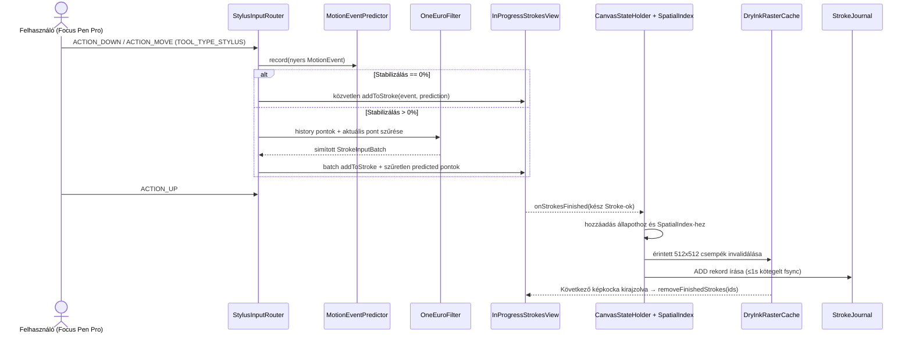

---

## 2. Lasszó Szellemkép-mentes Mozgatás (Vonások + Objektumok), Sarok-Forgatás és `✨ AI` Automatikus Formázás

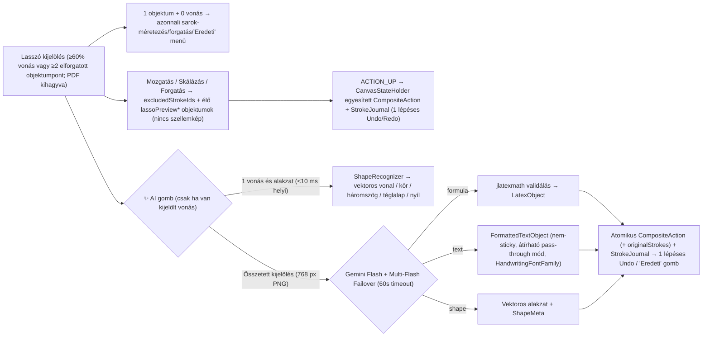

---

## 3. Adatbiztonság: Append-Only Journal, Atomikus Snapshot és Crash Recovery

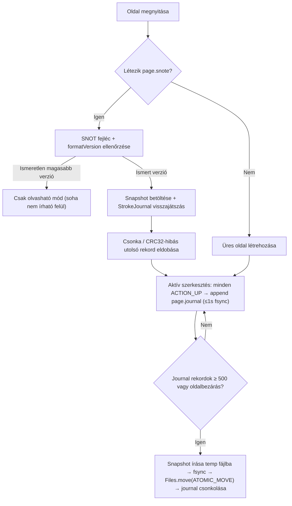

---

## 4. 1-ujjas Függőleges Pan & 2-ujjas Pinch-Zoom a 144 Hz-es GPU Kompozit Gyorsítótáron

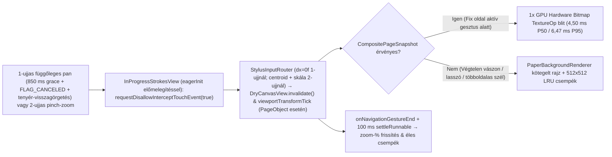

---

## 5. Könyvespolc Drag & Drop Rendszerezés, Szelektív PDF és NotebookLM Megosztás

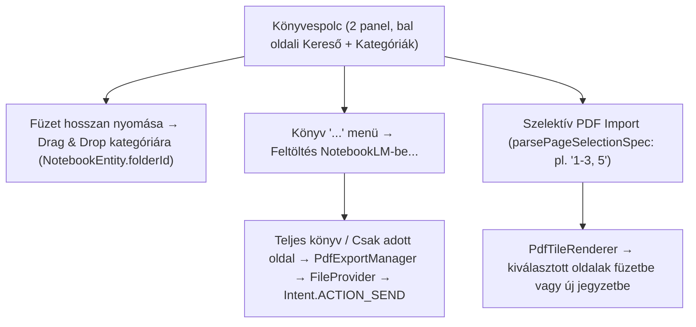

---

## 6. Lebegő Eszköztár, StarNote Színes Ikonok, Eszközmemória & AI Formázó

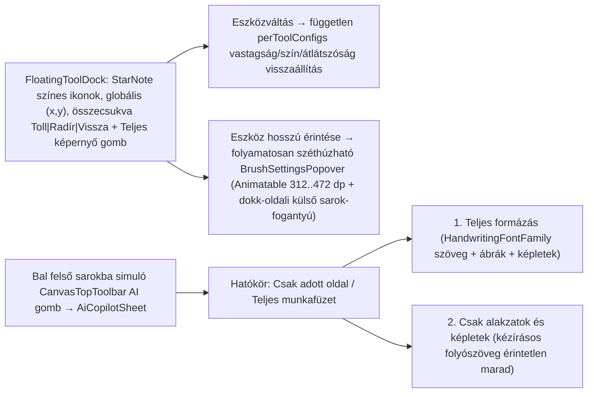

---

## 7. Geometriai Alakzatok (2D→3D), Képbeszúrás & Oldalak Drag & Drop Átrendezése

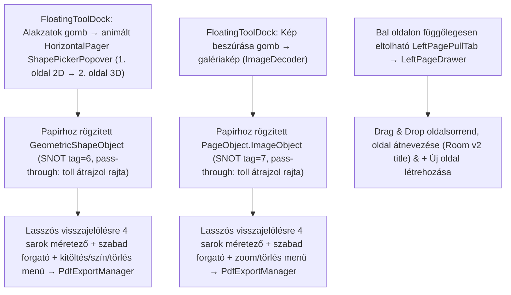

## 8. Inkrementális Felhőszinkron (Google Drive / WebDAV) és .zip Visszaállítás
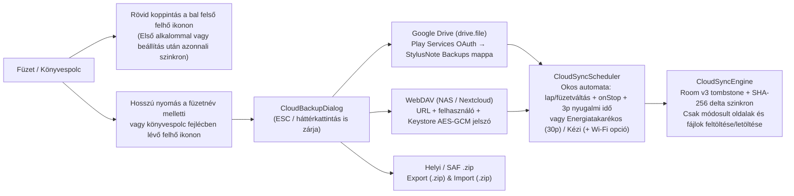

---

## 9. Élő Jegyzetbeli Kézírás- és Objektumkereső + Tartós AI Visszavonás

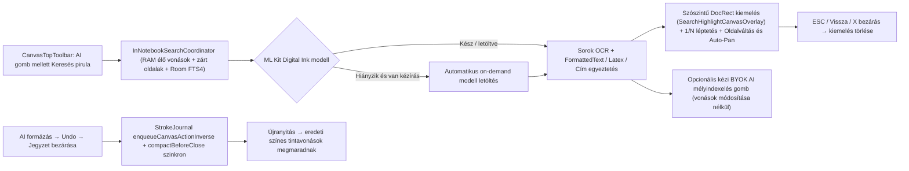

---

## 10. Folytonos Többoldalas Dokumentumtér, Sliding-Window Oldalpool & Valódi FrameMetrics Telemetria

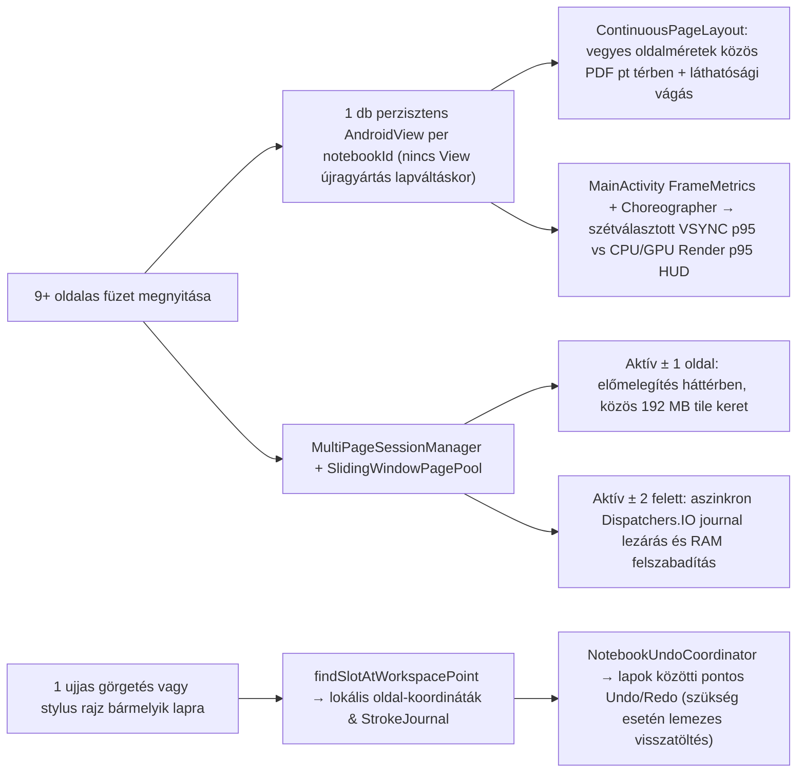

---

## 11. Élő PDF Háttér, Tinta Alatti Kép Horgonyzással, Valós Miniatűr Oldalfiók & Oldaltörlés

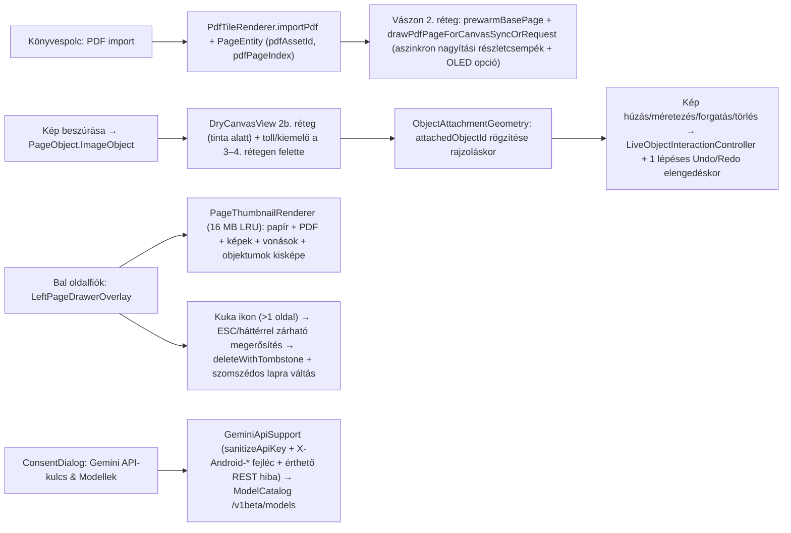

---

## 12. PDF Központosítás, Pontos Oldal- és Szakasz-Visszatöltés & Focus Pen Gombváltás

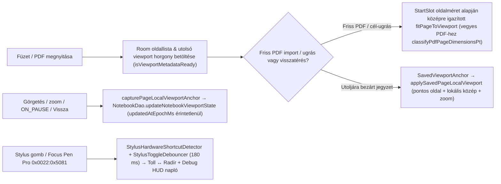

---

## 13. Alacsony Késleltetésű Unbuffered & Zero-Allocation Stylus Pipeline (XI. Ütem)

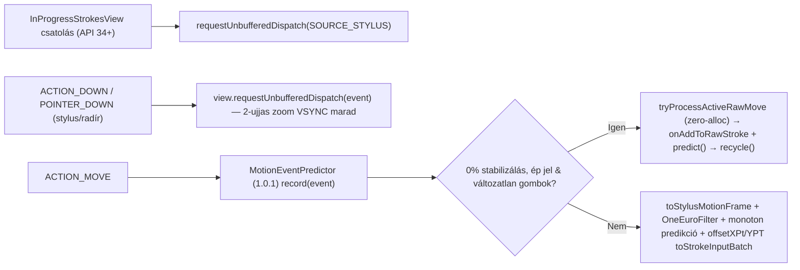

---

## 14. Kitakaró Szalag, Kódblokk Zónák & Élő LaTeX/Matek Munkafolyamatok (XII. Ütem)

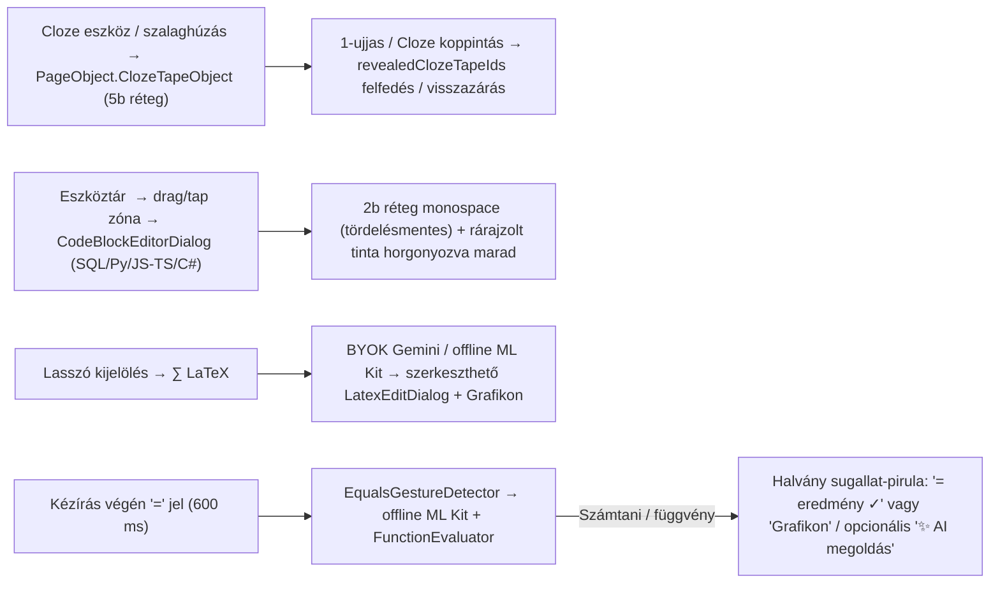

---

## 15. Oldalközi Lasszó Áthelyezés/Vágólap & Statikus `N × M` Táblázat (XIII. Ütem)

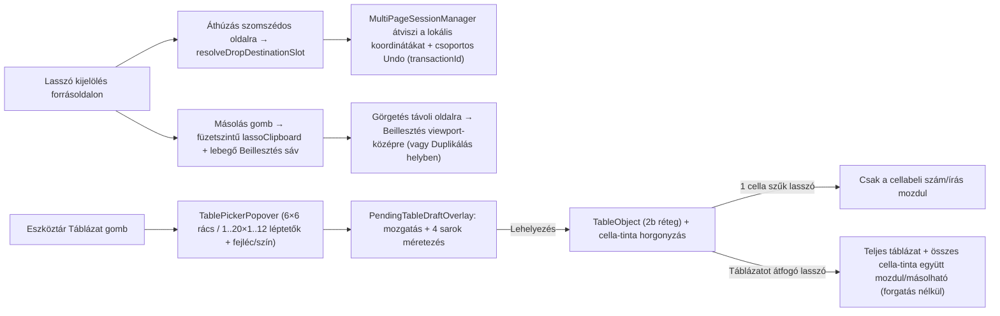

---

## 16. Finomított `∑ LaTeX`, Teljes Szélességű Eszköztár & Tehetetlenségi Görgetés (XIV. Ütem)

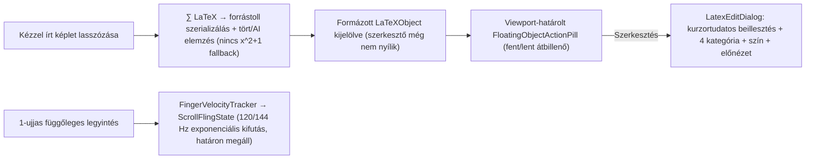

---

## 17. 7 Napos Felhős Lomtár, Kategória Drive PDF Mentés & Radiális Kör-Menü (XV. Ütem)

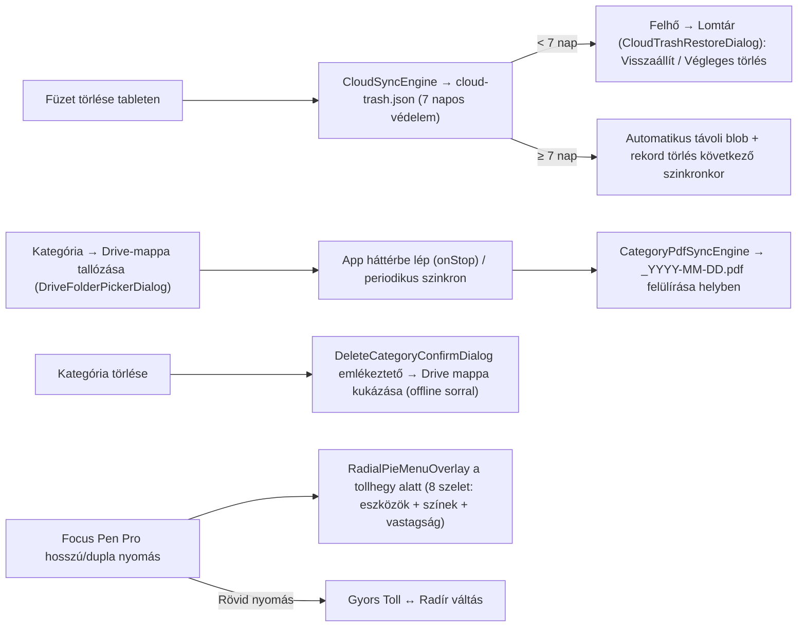

