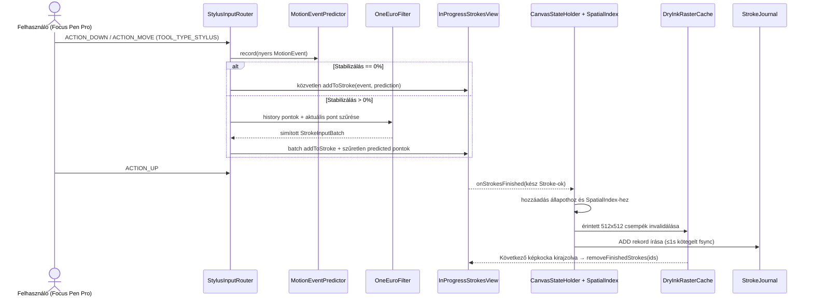
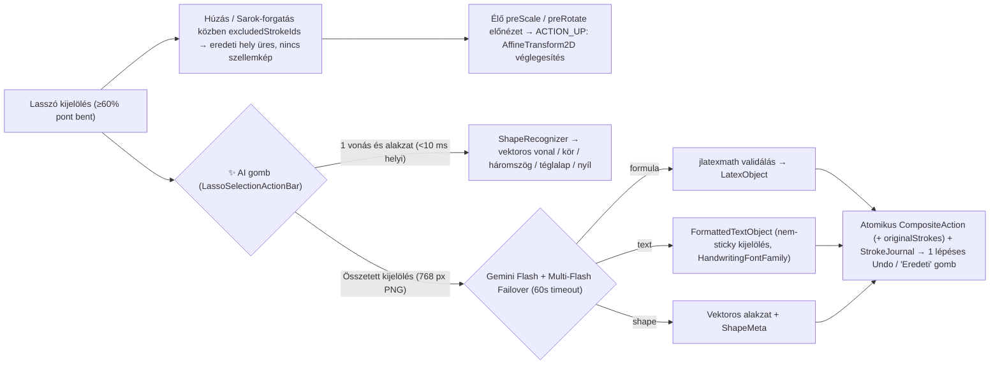
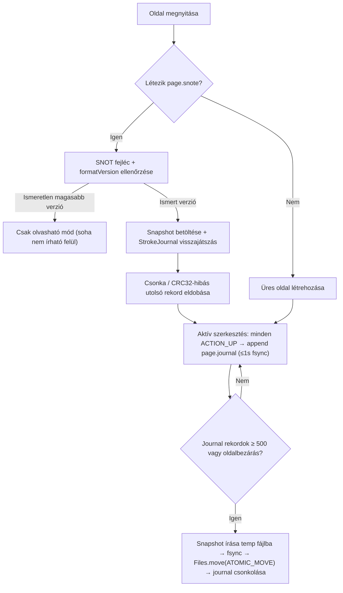
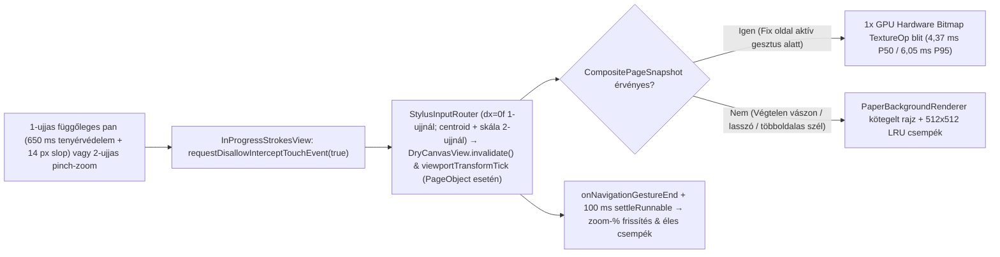
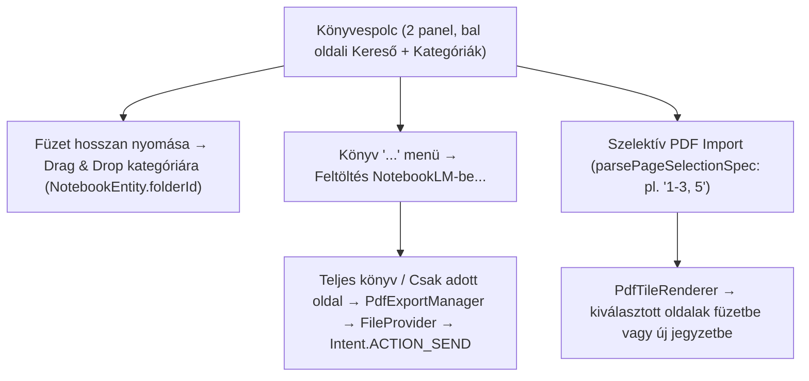
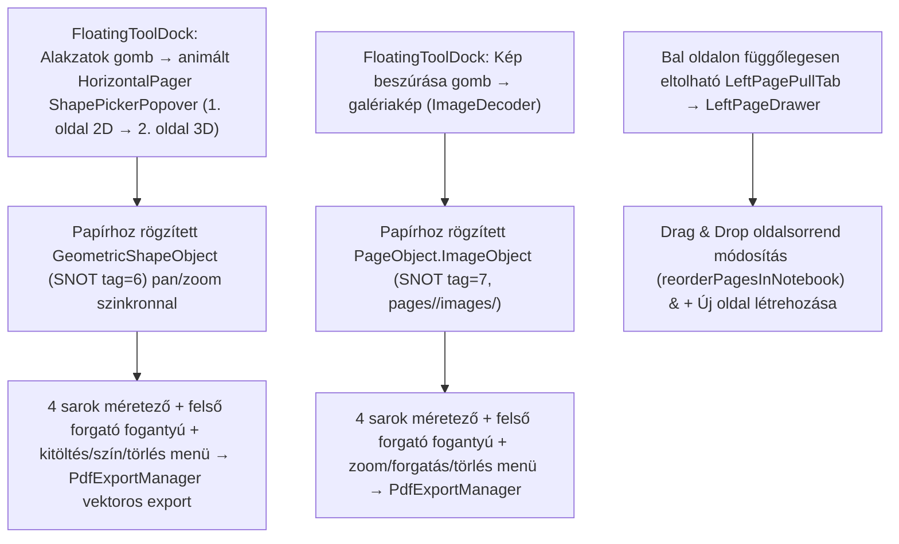

# StylusNote – Felhasználói Folyamatok (User Journeys)

Ez a dokumentum a főbb felhasználói és adatfeldolgozási folyamatokat ábrázolja Mermaid diagramokkal.

---

## 1. 144 Hz Tollvonás és Villogásmentes Wet→Dry Átadás

---

## 2. Lasszó Szellemkép-mentes Mozgatás, Sarok-Forgatás és `✨ AI` Automatikus Formázás

---

## 3. Adatbiztonság: Append-Only Journal, Atomikus Snapshot és Crash Recovery

---

## 4. 1-ujjas Függőleges Pan & 2-ujjas Pinch-Zoom a 144 Hz-es GPU Kompozit Gyorsítótáron

---

## 5. Könyvespolc Drag & Drop Rendszerezés, Szelektív PDF és NotebookLM Megosztás

---

## 6. Lebegő Eszköztár, StarNote Színes Ikonok, Eszközmemória & AI Formázó

---

## 7. Geometriai Alakzatok (2D→3D), Képbeszúrás & Oldalak Drag & Drop Átrendezése

