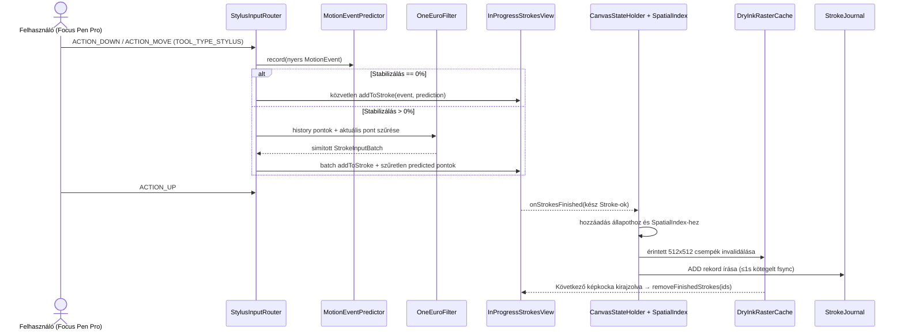
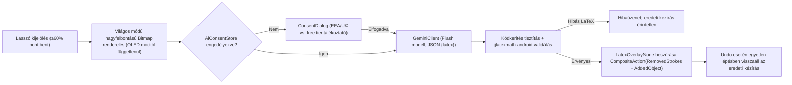
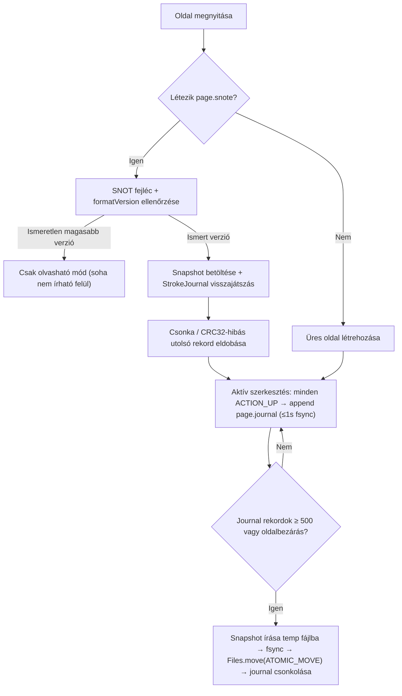
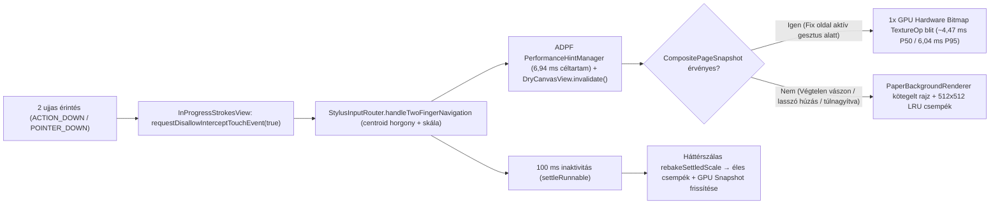

# StylusNote – Felhasználói Folyamatok (User Journeys)

Ez a dokumentum a főbb felhasználói és adatfeldolgozási folyamatokat ábrázolja Mermaid diagramokkal.

---

## 1. 144 Hz Tollvonás és Villogásmentes Wet→Dry Átadás

---

## 2. Lasszó → Natív LaTeX Konverzió és Undo

---

## 3. Adatbiztonság: Append-Only Journal, Atomikus Snapshot és Crash Recovery

---

## 4. Kétujjas Pan & Pinch-Zoom a 144 Hz-es GPU Kompozit Gyorsítótáron

